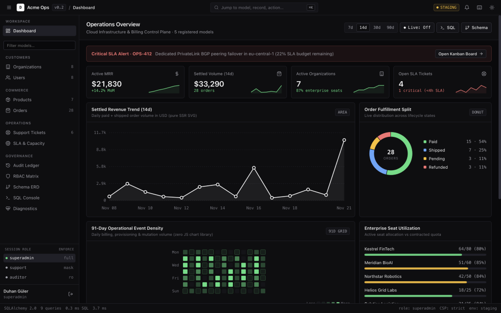
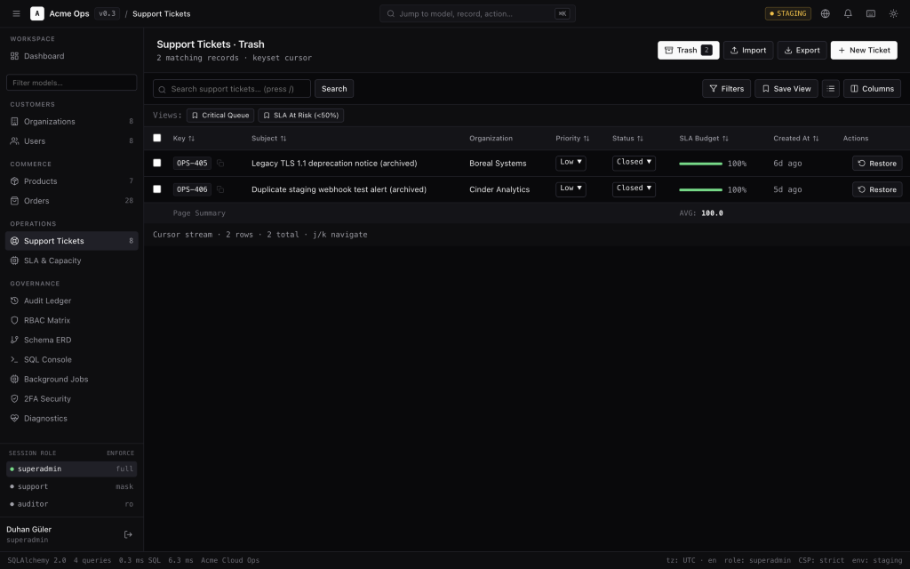
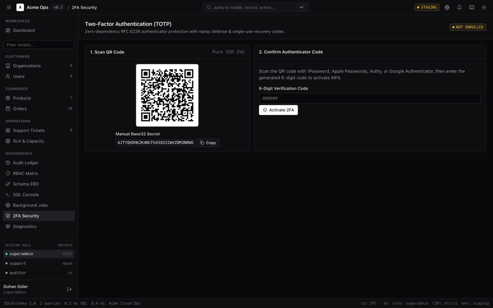
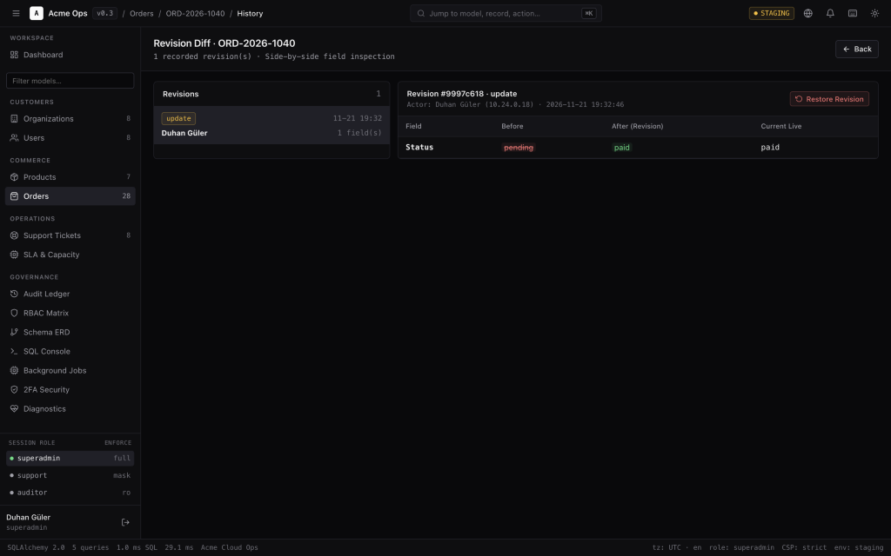
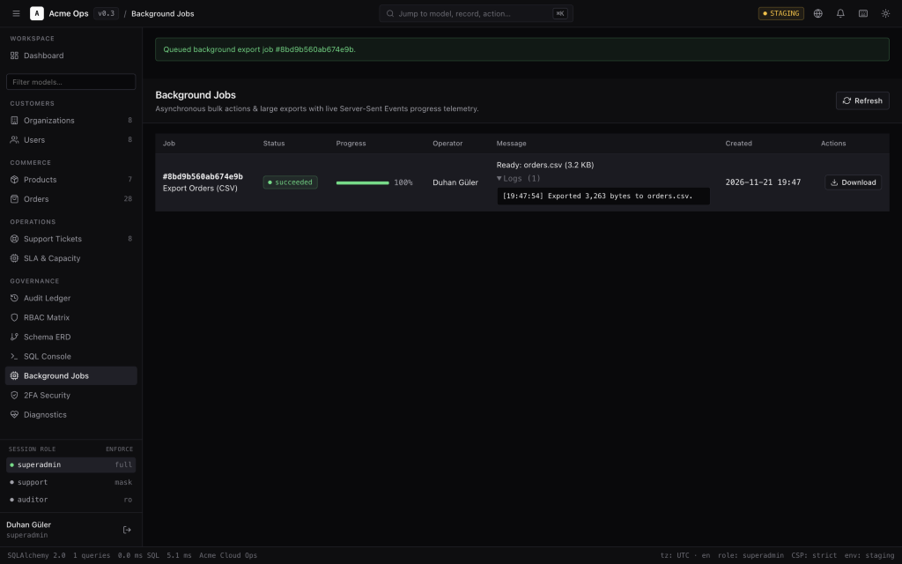
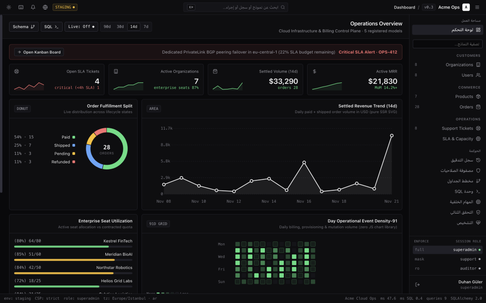
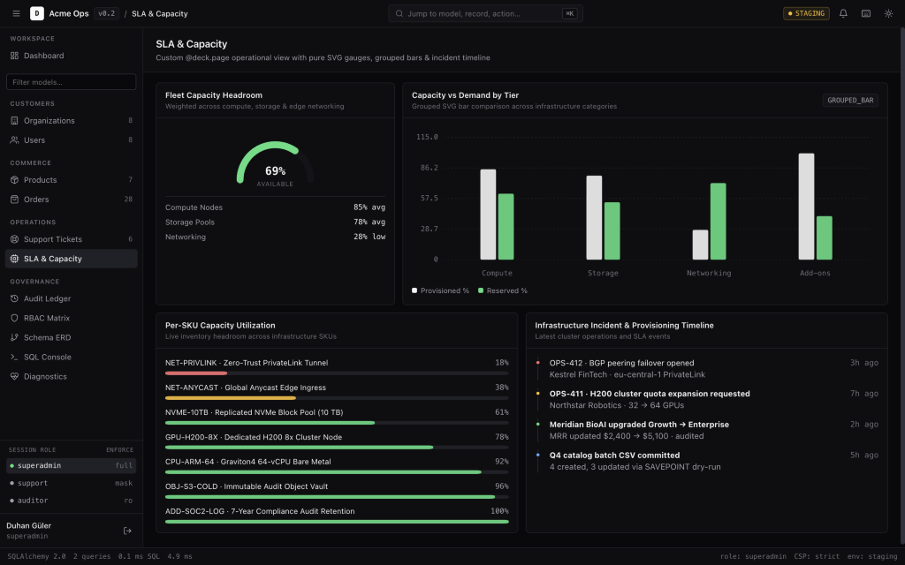
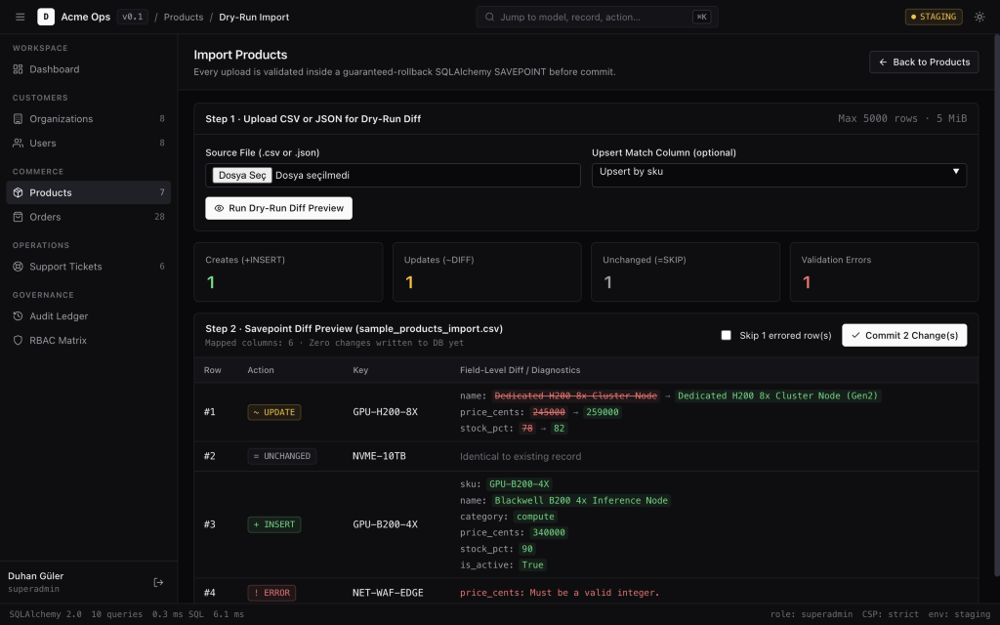
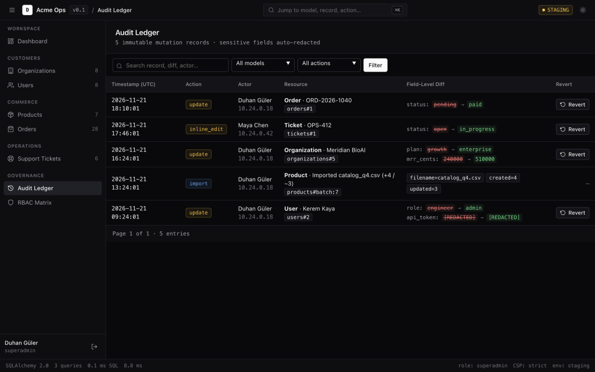

<p align="center">
  
</p>

<p align="center">
  <a href="https://github.com/duhanguler/flask-deck/actions/workflows/ci.yml"></a>
  <a href="https://pypi.org/project/flask-deck/"></a>
  
  
  
  
  
  <a href="https://github.com/duhanguler/flask-deck/blob/main/LICENSE"></a>
</p>

# flask-deck

**A precision, fail-closed Enterprise & AI-Agent Operations Control Plane for Flask and SQLAlchemy 2.0** — engineered for teams that want the visual craft of **Django-Unfold / Filament / Linear** plus enterprise IAM (SSO, Passkeys, encrypted TOTP), four-eyes Maker-Checker approvals, hash-chained audit ledgers, headless REST API v1, HITL MCP agent tooling, media storage, i18n/RTL, and SQL BI charts on WSGI — without shipping Bootstrap, jQuery, Node build pipelines, or external CDNs.

- **Zero Node Build · Zero External CDN · `< 18 KB` Core / `< 24 KB` Route gzip budgets** (`9.22 KB` CSS + `6.41 KB` core JS = `15.63 KB` gzip core; modular grid/form/ops route totals `18.12–20.89 KB` gzip + pure SSR SVG visualizations & QR codes). Runs out of the box in air-gapped enterprise environments.
- **Carbon Dark, Swiss Light & Strict-CSP Brand Themes**: `1px` hairline grids, `tabular-nums`, CSS Logical Properties for native **RTL**, custom `#RRGGBB` brand accents served over external `/_theme.css` (auto WCAG 2.1 contrast, **0 `'unsafe-inline'`**), and 7 allowlisted extension slots.
- **Enterprise Control Plane & AI-Agent Platform (`v0.4.0`)**:
  1. **Enterprise IAM 2.0 & Tamper-Evident Audit**: Encrypted TOTP 2FA (`SecretCipher`), WebAuthn **Passkeys**, PKCE OIDC SSO, Session Registry (`/_security/sessions`), Four-Eyes **Approval Workflows (`/_approvals`)**, 3-way **OCC**, Server-Side **Saved Views & Notes**, and Hash-Chained **Audit Ledger (`verify_chain()`)**.
  2. **Headless REST API v1 & HITL MCP Server**: Scoped Bearer **API Keys** (`dk_live_...`, CIDR allowlist, sliding-window rate limiting), OpenAPI 3.1.0 `/_api/v1/...`, and JSON-RPC 2.0 **MCP Server** (`POST /_mcp` & `flask deck mcp`) with savepoint-validated agent proposals.
  3. **Workspace 2.0 & SQL Workbench 2.0 BI**: **Table, Kanban Board, Calendar, Gallery & Cycle-Safe Tree** views, universal scalar inline edits, clickable FK badges, 1-to-N sub-tables, whole-dataset currency aggregates (`aggregate_scope="all"`), dotted FK filters, `__in`/`__not_in`/`__fts`, multi-bind Schema Browser, `EXPLAIN`, SVG Bar/Line charts & pinned Dashboard BI tiles.
  4. **Import/Export 2.0, ORM Introspection 2.0 & CLI**: Interactive column-mapping wizard, failed-rows CSV download, async background imports, optional **XLSX** (`flask-deck[excel]`), `TypeDecorator`/`hybrid_property`/`column_property`/Joined-Table Inheritance, typed `widgets.py`, clickable zoomable SVG ERD, `flask deck scaffold`, `flask deck audit --format sarif`, and `flask-lens` auto-detection.

---

### Try the Live Demo in 5 Seconds

```bash
uvx flask-deck demo
# or
pip install flask-deck && flask-deck demo
```

Open `http://127.0.0.1:5055/admin/` and explore the **`showcase`** control-plane seed (32 orgs, 48 users, 18 products with thumbnails, 120 orders across 90 days, 42 tickets, 22 infrastructure tree nodes, 36 hash-chained audit entries, pending AI-agent/human approvals, saved SQL BI queries, API keys, webhooks & jobs):
- **Live RBAC Switching**: Bottom-left **SESSION ROLE** switcher (`Admin` / `Support` with live email PII masking / `Viewer` read-only) plus **Impersonate User**.
- **Workspace 2.0 Multi-Views & Media**: Browse `/admin/infrastructure/?view=tree`, `/admin/products/?view=gallery` (with Image Lightbox), `/admin/orders/?view=calendar`, `/admin/tickets/?view=board`, and Trash restore (`?trashed=1`).
- **Four-Eyes Approvals, Hash-Chained Audit & BI SQL**: Review pending AI-agent (`mcp-agent`) & human requests on `/admin/_approvals`, verify ledger integrity on `/admin/_audit`, or chart & pin BI queries on `/admin/_sql`.
- **IAM, Headless APIs, Jobs & Arabic RTL**: Visit `/admin/_security/mfa`, `/admin/_security/passkeys`, `/admin/_security/sessions`, `/admin/_security/api-keys`, `/admin/_webhooks`, `/admin/_jobs`, or switch to **العربية (AR)** + `Europe/Istanbul` in the topbar Globe popover.

#### Deploy Live Demo on Vercel

`flask-deck` includes a zero-config Vercel Flask entrypoint ([app.py](https://github.com/duhanguler/flask-deck/blob/main/app.py)) and [vercel.json](https://github.com/duhanguler/flask-deck/blob/main/vercel.json) scheduled reset configuration:
- **Daily `00:00` (`Europe/Istanbul`) Auto-Reset:** Vercel Schedules invokes `POST /api/cron/reset-demo` daily at `00:00 Europe/Istanbul` (protected by Bearer `CRON_SECRET`), and an in-process day-rollover guard automatically resets ephemeral/persistent demo state across midnight on the next request.
- **Optional Environment Variables:** `CRON_SECRET` (recommended on Vercel), `DATABASE_URL` / `FLASK_DECK_DEMO_DB_URI` (optional Postgres backing), `FLASK_DECK_SECRET_KEY`, `FLASK_DECK_DEMO_PROFILE` (`showcase` default or `standard`), `FLASK_DECK_AUTO_DAILY_RESET` (`1` default), `FLASK_DECK_RESET_TIMEZONE` (`Europe/Istanbul` default).

Optional extras (zero mandatory bloat in the base wheel):

```bash
pip install "flask-deck[s3]"          # boto3 for S3 / R2 / MinIO
pip install "flask-deck[babel]"       # Flask-Babel / Babel catalog integration
pip install "flask-deck[pydantic]"    # Pydantic v2 form validation adapter
pip install "flask-deck[excel]"       # openpyxl for .xlsx import & export
pip install "flask-deck[webauthn]"    # Passkeys / WebAuthn support
pip install "flask-deck[sso]"         # authlib for OIDC / OAuth2 SSO
pip install "flask-deck[redis]"       # Redis rate-limit & import preview stores
pip install "flask-deck[enterprise]"  # Full enterprise bundle
```

---

### Carbon Dark, Swiss Light & Enterprise Workbench Gallery

<p align="center">
  <picture>
    <source media="(prefers-color-scheme: dark)" srcset="https://raw.githubusercontent.com/duhanguler/flask-deck/main/docs/assets/dashboard-dark.png" />
    <source media="(prefers-color-scheme: light)" srcset="https://raw.githubusercontent.com/duhanguler/flask-deck/main/docs/assets/dashboard-light.png" />
    
  </picture>
</p>

<details>
  <summary>Explore All 18 Workbench &amp; Enterprise Views (Media Lightbox, 3-Step Wizard, Keyset Cursor &amp; Trash, TOTP QR, Side-by-Side Diff, Background SSE Jobs, Arabic RTL, Kanban, Heatmap, ERD, SQL Console &amp; More)</summary>
  <br />
  <p align="center"><strong>Products Media Grid &amp; Click-to-Open Image Lightbox (RBAC-Guarded <code>/_media</code> Proxy)</strong></p>
  <p align="center"></p>
  <p align="center"><strong>Multi-Step Form Wizard with Drag-and-Drop Image Upload &amp; Live DataURL Preview</strong></p>
  <p align="center"></p>
  <p align="center"><strong>HMAC-Signed Keyset Cursor Pagination &amp; Soft-Delete Trash / One-Click Restore</strong></p>
  <p align="center"></p>
  <p align="center"><strong>Built-In TOTP 2FA Enrollment with Pure-Python ISO/IEC 18004 SVG QR Code (Zero External Libs)</strong></p>
  <p align="center"></p>
  <p align="center"><strong>Per-Record Side-by-Side Revision Diff History &amp; Safe Revert (<code>/&lt;slug&gt;/&lt;pk&gt;/history</code>)</strong></p>
  <p align="center"></p>
  <p align="center"><strong>Background Jobs Console with Live SSE Progress, Logs &amp; Artifact Download (<code>/_jobs</code>)</strong></p>
  <p align="center"></p>
  <p align="center"><strong>Native Arabic RTL (<code>dir="rtl"</code>) &amp; Per-User Timezone (<code>Europe/Istanbul</code>) via CSS Logical Properties</strong></p>
  <p align="center"></p>
  <p align="center"><strong>Swiss Light Theme (Range Switcher + Callout + Pure SVG Area &amp; Donut Charts)</strong></p>
  <p align="center"></p>
  <p align="center"><strong>91-Day Activity Heatmap &amp; Ranked Stat Progress Bars (100% Pure SSR SVG)</strong></p>
  <p align="center"></p>
  <p align="center"><strong>Drag-and-Drop Kanban Board Mode (CSRF + RBAC + Audit Logged Transitions)</strong></p>
  <p align="center"></p>
  <p align="center"><strong>Tabbed Forms &amp; Zero-Dependency Rich Widgets (Segmented Pills, Toggle Switch, Tag Input, Code Editor)</strong></p>
  <p align="center"></p>
  <p align="center"><strong>Interactive SQLAlchemy Schema ERD Inspector (<code>/admin/_schema</code>)</strong></p>
  <p align="center"></p>
  <p align="center"><strong>Hardened Read-Only SQL Console with Automatic <code>[REDACTED]</code> Secret Masking (<code>/admin/_sql</code>)</strong></p>
  <p align="center"></p>
  <p align="center"><strong>Custom <code>@deck.page</code> Operations View (Radial SLA Gauge + Grouped Bar + Timeline)</strong></p>
  <p align="center"></p>
  <p align="center"><strong>Global ⌘K Command Palette (RBAC-Scoped Cross-Model Live Search)</strong></p>
  <p align="center"></p>
  <p align="center"><strong>Orders Grid + Quick Filter Tabs + 3-Tab Slide-Over Quick Peek Drawer</strong></p>
  <p align="center"></p>
  <p align="center"><strong>SAVEPOINT-Verified Dry-Run CSV/JSON Diff Import</strong></p>
  <p align="center"></p>
  <p align="center"><strong>Immutable Audit Ledger with Field-Level Diffs, Auto-Redaction &amp; Safe Revert</strong></p>
  <p align="center"></p>
</details>

---

## 5-Line Quickstart

```python
from flask import Flask
from flask_sqlalchemy import SQLAlchemy
from flask_deck import BasicAuthProvider, BrandConfig, Deck

app = Flask(__name__)
app.config["SECRET_KEY"] = "replace-with-32-byte-random-secret"
app.config["SQLALCHEMY_DATABASE_URI"] = "sqlite:///app.db"
db = SQLAlchemy(app)

deck = Deck(
    app,
    db,
    auth=BasicAuthProvider.from_plain_passwords({"admin": "change-me"}),
    title="Acme Ops",
    brand=BrandConfig(accent="cobalt", login_subtitle="Operations Control Plane"),
)
deck.register(Organization, User, Product, Order)
```

Using **pure SQLAlchemy 2.0** without `Flask-SQLAlchemy`? Pass `session_factory=SessionLocal, engine=engine` (and optional multi-DB `binds={"analytics": analytics_engine}`) directly — see [examples/pure_sqlalchemy_app.py](https://github.com/duhanguler/flask-deck/blob/main/examples/pure_sqlalchemy_app.py).

---

## Declarative `ModelView`: Media, Wizards, Cursor Pagination, Soft-Delete & Async Jobs

```python
from types import MappingProxyType
from flask_deck import (
    CodeFormatter,
    CurrencyFormatter,
    FileFieldConfig,
    FileFormatter,
    ImageFormatter,
    LocalFileStorage,
    ModelView,
    action,
)

uploads = LocalFileStorage("./uploads")


class ProductView(ModelView):
    model = Product
    icon = "package"
    category = "Catalog"
    columns = ("thumbnail_key", "sku", "name", "price_cents", "stock", "spec_key")
    filterable_columns = ("category", "is_active", "specs_json")

    # 3-Step Form Wizard + Secure File/Image Fields
    form_layout = "wizard"
    fieldsets = (
        ("Catalog Identity", ("sku", "name", "category", "is_active")),
        ("Pricing & Media", ("price_cents", "stock", "thumbnail_key", "spec_key")),
        ("Structured Metadata", ("specs_json",)),
    )
    file_fields = MappingProxyType({
        "thumbnail_key": FileFieldConfig(
            storage=uploads,
            kind="image",
            prefix="products/thumbnails",
            max_bytes=2 * 1024 * 1024,
        ),
        "spec_key": FileFieldConfig(
            storage=uploads,
            kind="file",
            prefix="products/specs",
            allowed_mimes=frozenset({"application/pdf"}),
            max_bytes=10 * 1024 * 1024,
        ),
    })
    column_formatters = MappingProxyType({
        "thumbnail_key": ImageFormatter(alt_prefix="Product"),
        "sku": CodeFormatter(copyable=True),
        "price_cents": CurrencyFormatter(currency="USD", divisor=100),
        "spec_key": FileFormatter(),
    })


class OrderView(ModelView):
    model = Order
    icon = "shopping-bag"
    category = "Commerce"
    columns = ("order_number", "organization", "customer", "status", "total_cents", "created_at")
    searchable_columns = ("order_number", "organization.name", "customer.email")
    filterable_columns = ("status", "organization_id", "total_cents", "created_at")
    inline_editable_columns = ("status",)
    inlines = (OrderItemInline,)

    # Opt-in Kanban Board + Page Summary Footer + Cascading FK + Conditional Visibility
    kanban_column = "status"
    kanban_card_fields = ("order_number", "organization", "total_cents")
    column_aggregates = MappingProxyType({"total_cents": "sum"})
    field_widgets = MappingProxyType({"status": "segmented", "notes": "markdown"})
    saved_views = (("High Value", "?f_total_cents__gte=100000"),)
    dependent_fields = MappingProxyType({"customer_id": ("organization_id", "organization_id")})
    field_conditions = MappingProxyType({"notes": ("status", "in", ("refunded", "cancelled"))})

    @action("sync_erp", label="Sync to ERP (Background Job)", icon="activity", async_job=True)
    def sync_erp(self, records, form_data, user, job_ctx):
        total = max(len(records), 1)
        for idx, order in enumerate(records, start=1):
            if job_ctx.is_cancelled():
                return "ERP sync cancelled."
            job_ctx.set_progress(int(idx * 100 / total), f"Synced {order.order_number}")
        return f"Synced {len(records)} order(s) to ERP."


class TicketView(ModelView):
    model = Ticket
    pagination_mode = "cursor"        # HMAC-signed keyset cursor (LIMIT N+1)
    count_mode = "estimated"          # O(1) pg_class.reltuples on PostgreSQL
    soft_delete_column = "deleted_at" # Automatic Trash tab, Restore & Force Delete
```

---

## Events, Webhooks & Custom Operations Pages

```python
from flask_deck import WebhookSink

# Typed in-process event bus
@deck.on("record.updated")
def on_record_updated(event):
    print(f"{event.actor_name} updated {event.model_slug}#{event.record_pk}")

# SSRF-hardened HMAC-SHA256 webhook sink (blocks loopback, RFC 1918, CGNAT & 169.254.169.254)
deck.add_webhook(
    WebhookSink(
        url="https://hooks.example.com/admin-events",
        secret="whsec_replace_me",
        events=frozenset({"record.created", "record.deleted", "action.executed"}),
    )
)
```

---

## Governance, Workspace 2.0 Views & AI-Agent Control Plane (`v0.4.0`)

```python
from flask_deck import (
    CodeWidget,
    ColorWidget,
    Deck,
    ModelView,
    SliderWidget,
    TagInputWidget,
)

class InfrastructureNodeView(ModelView):
    model = InfrastructureNode
    tree_parent_field = "parent_id"       # Cycle-safe Tree Hierarchy (?view=tree)
    tree_title_field = "name"
    calendar_date_field = "created_at"    # Opt-in Month Calendar (?view=calendar)
    gallery_image_field = "thumb_key"     # Opt-in Media Gallery (?view=gallery)
    aggregate_scope = "all"               # Whole-filtered dataset summary footer
    approval_required = ("edit", "delete")  # Four-Eyes Maker-Checker workflow
    field_widgets = {
        "accent_color": ColorWidget(),
        "health_pct": SliderWidget(min_value=0, max_value=100, unit="%"),
        "labels": TagInputWidget(),
        "topology_yaml": CodeWidget(language="yaml", rows=6),
    }

deck = Deck(
    app,
    db,
    auth=auth,
    enable_sql_console=True,
    enable_rest_api=True,      # OpenAPI 3.1.0 REST API at /admin/_api/v1/...
    enable_mcp=True,           # JSON-RPC 2.0 MCP Server at POST /admin/_mcp
    mcp_require_approval=True, # AI-agent writes validate via SAVEPOINT -> /_approvals
)
```

Run the local stdio MCP server for desktop AI clients with `flask --app yourapp deck mcp`.

---

## Ecosystem Comparison

| Capability | **flask-deck `v0.4`** | `flask-admin` v2.2 | `flask-appbuilder` | `sqladmin` | `django-unfold` |
| :--- | :---: | :---: | :---: | :---: | :---: |
| **Flask / WSGI Native** | **Yes** | Yes | Yes | No (ASGI) | No (Django) |
| **Pure SQLAlchemy 2.0 + Multi-Bind DBs** | **Yes** | Partial | No | Yes | N/A |
| **Zero Node Build & Zero CDN** | **Yes (`15.6 KB` core / ≤`20.9 KB` route gz)** | Partial | Partial | No | Partial |
| **Media Upload (Local + S3/R2/MinIO + Lightbox)** | **Yes (Magic-byte + Bomb guard)** | Local only | Partial | Via lib | Via Django |
| **Built-In i18n, Native RTL & Per-User TZ** | **Yes (CSS Logical Props)** | Babel | Babel | No | Yes |
| **Strict-CSP Dynamic Brand Theme & Slots** | **Yes (`/_theme.css`)** | Manual | Manual | Manual | Tailwind |
| **TOTP 2FA (Encrypted), Passkeys & OIDC SSO** | **Yes (Pure SVG QR + WebAuthn)** | No | OAuth only | No | Via plugins |
| **Active Sessions Registry + Audited Impersonation** | **Yes** | No | No | No | Via plugin |
| **Four-Eyes Approvals & 3-Way OCC Locking** | **Yes (`ETag` / `If-Match`)** | No | No | No | No |
| **Headless REST API v1 + Scoped API Keys** | **Yes (`OpenAPI 3.1.0` + CIDR/RL)** | No | Partial | No | DRF / Ninja |
| **HITL MCP Server for AI Agents** | **Yes (`/_mcp` + `flask deck mcp`)** | No | No | No | No |
| **Keyset Cursor Pagination + PG `JSONB`/`ARRAY`** | **Yes (HMAC cursor + `__fts`)** | No | No | No | Partial |
| **Calendar / Gallery / Tree + Kanban + BI SQL Charts** | **Yes (`EXPLAIN` + pinned SVG tiles)** | No | No | No | Partial |
| **Column-Map Wizard CSV/XLSX + Diff Revert** | **Yes (Hash-chained audit + XLSX)** | CSV only | No | No | Via plugin |
| **4-Level RBAC + Field Masking + Matrix UI** | **Yes** | Manual | Partial | Manual | Via Django |
| **Strict Nonce CSP (`0 unsafe-inline`)** | **Yes** | No | No | No | No |

---

## Performance Architecture & Benchmarks

Measured on Python 3.13 + SQLAlchemy + SQLite via `uv run python benchmarks/bench_deck.py`:

| Workload | Result | Engineering Mechanism |
| :--- | :--- | :--- |
| **Frontend Asset Payload** | **`15.63 KB` core gzip** (`9.22 KB` CSS + `6.41 KB` core JS) · **`18.12–20.89 KB`** per-route total | Modular vanilla ES6 (`deck.js` + route-scoped `deck-grid.js` / `deck-form.js` / `deck-ops.js`), zero icon fonts, zero chart or QR libraries; SHA-256 immutable caching (`?v=<hash>`). |
| **Offset List View (50 / 2,000 rows + FK + 4 Tabs)** | **`6.36 ms` p50 · `4` SQL queries** | Auto `joinedload`/`selectinload` (zero N+1), single-pass `CASE` Quick Tab & Trash aggregation, `defer()` heavy blobs, single-query sidebar counts. |
| **Keyset Cursor List (50 / 2,000 rows, `count=none`)** | **`6.16 ms` p50 · `4` SQL queries** | HMAC-signed opaque cursor (`LIMIT N+1`, no `OFFSET` table scan, zero `COUNT(*)` overhead). |
| **Streaming CSV Export (2,000 rows)** | **`60.2 ms` (`33,238 rows/s`) · `2.8 MB` peak** | `session.scalars(stmt).yield_per(500)` + generator streaming (`O(1)` RAM) shared with Background CSV Jobs; CSV/XLSX formula neutralization. |
| **Dry-Run Savepoint Import (1,000 rows)** | **`194.5 ms` · `0` leaked mutations** | Chunked `IN (...)` batch preload (`batch_size=500`) + released `SAVEPOINT` validation + unconditional `finally: rollback()`; auto-async job above `max_sync_import_rows`. |

Every page footer displays live request telemetry (`SQLAlchemy 2.0 · 4 queries · 0.3 ms SQL · 8.1 ms`) measured via lightweight request-scoped SQLAlchemy event listeners.

---

## Security Architecture (OWASP Defense-in-Depth)

| Vector | Built-in Protection in `flask-deck` |
| :--- | :--- |
| **Unauthenticated Exposure** | **Fail-closed:** Refuses to mount when `app.debug is False` without an explicit `AuthProvider` or `SECRET_KEY` (`SecurityConfigurationError`). Demo role switcher is hard-blocked whenever `environment == "production"`. |
| **XSS & Script Injection** | Strict per-request nonce CSP (`default-src 'none'; script-src 'self' 'nonce-…'; style-src 'self'; frame-ancestors 'none'`), zero `'unsafe-inline'`, zero `<style>`, zero inline `style=` or `on*=`, zero untrusted `innerHTML`, validated `#RRGGBB` `/_theme.css`, safe allowlisted `template_slots`. |
| **File Upload & Media Attacks** | Pure-Python magic-byte MIME verification (SVG XSS blocked by default), PNG/JPEG/GIF/WebP header decompression-bomb guard (`max_image_pixels`), path-traversal-proof storage keys, RBAC + `scope_query` enforcement on `/_media`, `X-Content-Type-Options: nosniff`, `Content-Disposition: attachment`. |
| **Account Takeover & SSO** | `SecretCipher`-encrypted TOTP 2FA secrets & recovery codes at rest (HKDF + AES/Fernet or HMAC fallback), WebAuthn Passkeys, PKCE `S256` + `state`/`nonce` OIDC SSO with `allowed_domains`, server-side Session Registry (`/_security/sessions`) with remote revocation, sliding-window login rate limiter (`HTTP 429` + `Retry-After`), `session.clear()` fixation rotation, and audited superuser Impersonation (`impersonated_by`). |
| **CSRF, Replay & Clickjacking** | Cryptographic per-session token (`hmac.compare_digest`) + `Sec-Fetch-Site` / `Origin` enforcement on every cookie mutation (plus Origin-rebinding guard on `/_mcp`), optimistic concurrency control (`ETag` / `If-Match` `409 Conflict`), and `X-Frame-Options: DENY`. |
| **Governance, Agents & APIs** | Declarative four-eyes `approval_required` Maker-Checker queue across UI, REST API v1 (`202 Accepted`), and AI-Agent MCP proposals; SHA-256 hashed Bearer API keys (`dk_live_...`) with scoped permissions, CIDR allowlists, and sliding-window `429 Retry-After` throttling. |
| **Mass Assignment & Tampering** | Strict `allowed_form_fields()` allowlist rejecting tampered PK/computed/readonly/hidden/sensitive fields (including on `?clone=`); uniform `scope_query` everywhere; optional cryptographic SHA-256 hash-chained Audit Ledger (`hash_chain=True`, `verify_chain()`). |
| **SSRF & Data Exfiltration** | `WebhookSink` validates DNS & pinned target IPs (incl. DNS-rebinding & DLQ tracking), blocking loopback, RFC 1918 private, link-local, and cloud metadata endpoints (`169.254.169.254`, `127.0.0.1`, `::1`). Opt-in superuser `/_sql` console enforces multi-layer read-only SQL firewall + automatic `[REDACTED]` masking. |

### Built-In CLI & In-App Security Auditor

```bash
flask --app yourapp deck info
flask --app yourapp deck audit --format text   # text | json | sarif (SARIF 2.1.0)
flask --app yourapp deck scaffold             # Generate ModelView boilerplate from ORM metadata
flask --app yourapp deck mcp                  # Start stdio JSON-RPC 2.0 MCP server
flask --app yourapp deck jobs list            # Inspect / trigger @deck.scheduled_job tasks
```

Both `flask deck audit` and `/admin/_diagnostics` inspect `SECRET_KEY` entropy, session cookie flags (`HttpOnly`, `SameSite`, `Secure`), `OpenAuthProvider` misuse, MFA/encryption/impersonation posture, REST/MCP posture, SQL console posture, unindexed `searchable_columns`, and auto-detected `flask-lens` telemetry.

---

## Migrating from `flask-admin`

See the 1-to-1 migration guide in [docs/migration-from-flask-admin.md](https://github.com/duhanguler/flask-deck/blob/main/docs/migration-from-flask-admin.md).

## Development

```bash
git clone https://github.com/duhanguler/flask-deck.git
cd flask-deck
uv sync --extra dev
make check
```

## License

MIT © 2026 [Duhan Güler](https://github.com/duhanguler)
