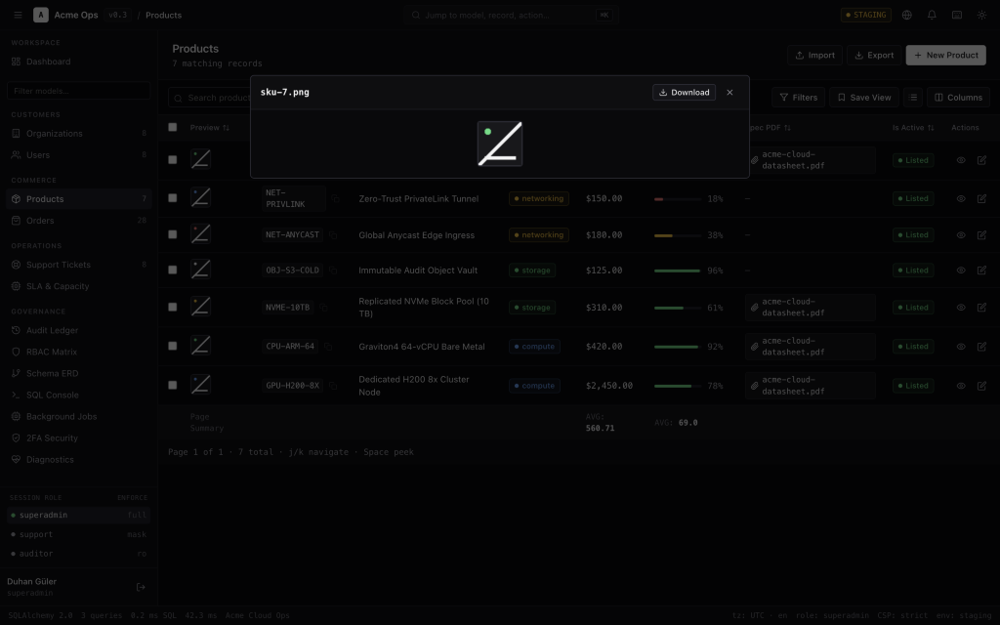
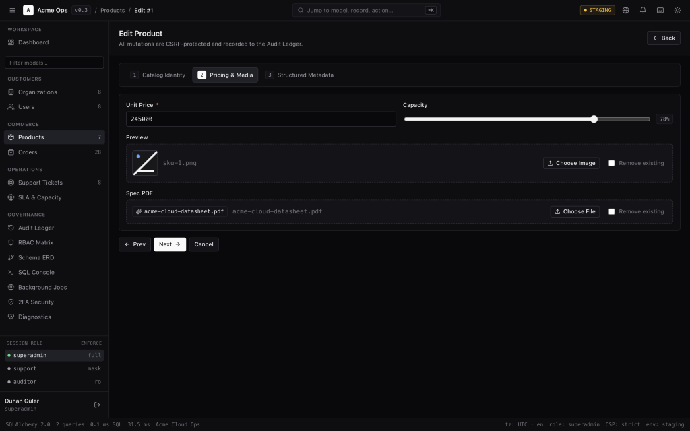
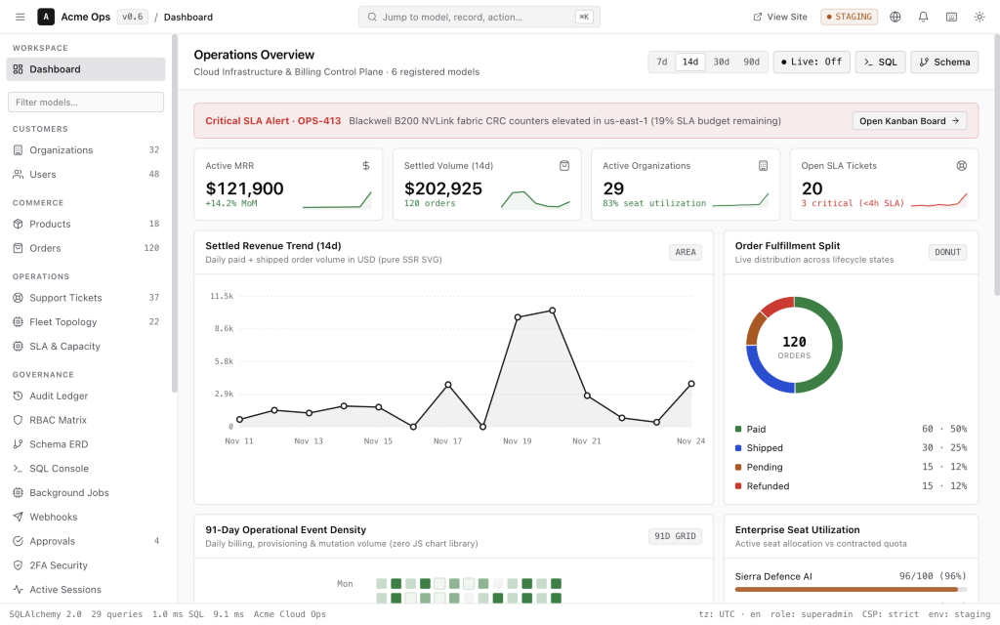
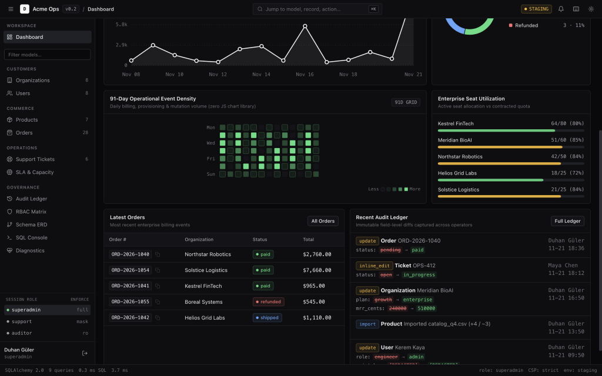
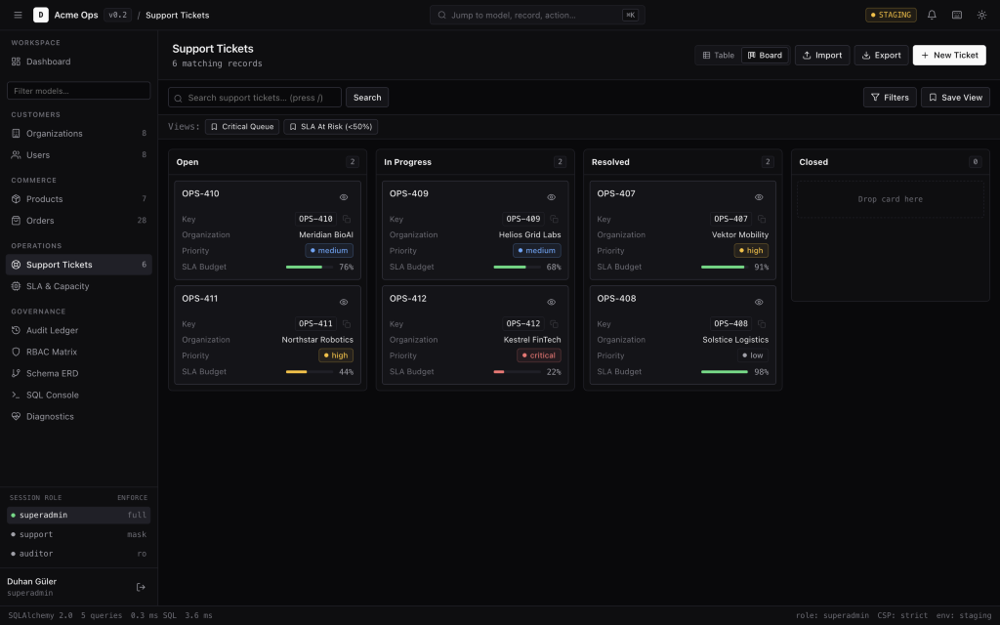
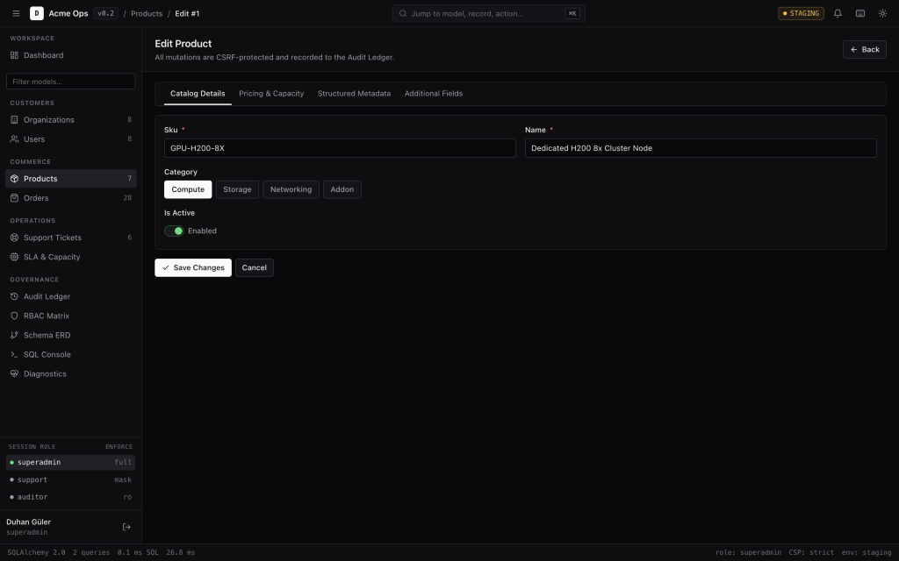
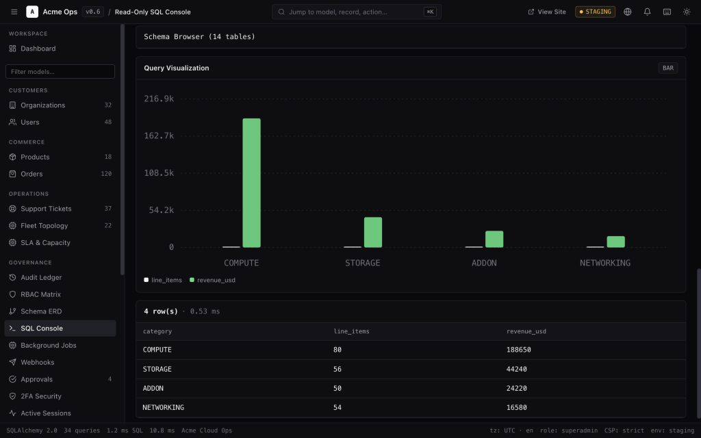
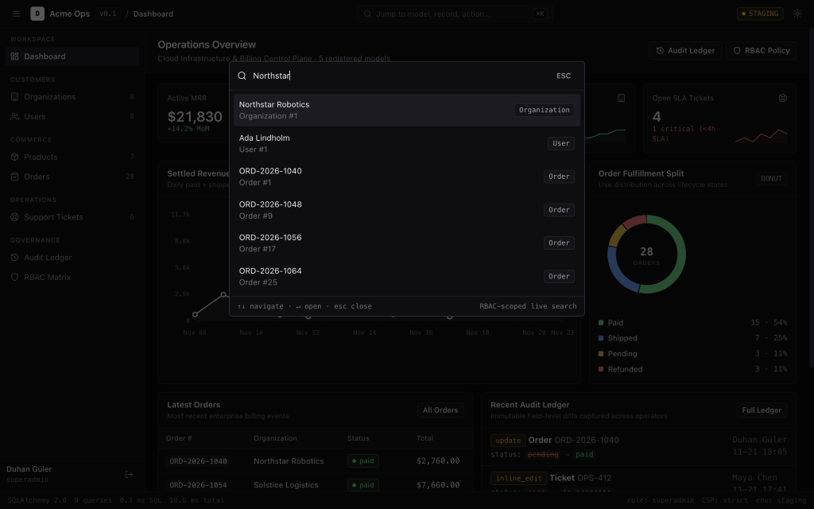

<p align="center">
  
</p>

<p align="center">
  <a href="https://github.com/duhanguler/flask-deck/actions/workflows/ci.yml"></a>
  <a href="https://pypi.org/project/flask-deck/"></a>
  
  
  
  
  
  <a href="https://github.com/duhanguler/flask-deck/blob/main/LICENSE"></a>
</p>

# flask-deck

**A precision, fail-closed Enterprise Admin Panel & Operations Workbench for Flask and SQLAlchemy 2.0** — engineered for teams that want the visual craft of **Django-Unfold / Filament / Linear** plus enterprise security, media storage, i18n/RTL, cursor pagination, background SSE jobs, and pure-Python TOTP 2FA on WSGI — without shipping Bootstrap, jQuery, Node build pipelines, or external CDNs.

- **Zero Node Build · Zero External CDN · `23.6 KB` gzip total** (`8.83 KB` CSS + `14.76 KB` vanilla ES6 JS + inline SVGs + pure SSR SVG visualizations & QR codes). Runs out of the box in air-gapped enterprise environments.
- **Carbon Dark, Swiss Light & Strict-CSP Brand Themes**: `1px` hairline grids, `tabular-nums`, CSS Logical Properties for native **RTL**, custom `#RRGGBB` brand accents served over external `/_theme.css` (auto WCAG 2.1 contrast, **0 `'unsafe-inline'`**), and 7 allowlisted extension slots.
- **8 Enterprise Capabilities Built In (`v0.3.0`)**:
  1. **Media, File Uploads & Object Storage (`LocalFileStorage`, `S3StorageBackend` for S3/R2/MinIO)**: Pure-Python magic-byte MIME validation (SVG XSS blocked by default), PNG/JPEG/GIF/WebP decompression-bomb protection, drag-and-drop dropzone, **Image Lightbox**, and RBAC-guarded `/_media` streaming proxy.
  2. **Enterprise i18n, Native RTL & Per-User Timezones**: Built-in `en`/`tr`/`de`/`ar` catalogs (`DictTranslator`) + optional `BabelTranslator`, native `dir="rtl"` logical layout, stdlib `ZoneInfo` UTC ↔ local TZ conversion, and Topbar Globe switcher.
  3. **Built-In Pure-Python TOTP 2FA, OIDC/OAuth2 SSO & Audited Impersonation**: RFC 6238 TOTP with replay prevention, PBKDF2 recovery codes, **pure-Python ISO/IEC 18004 SVG QR generator**, PKCE `S256` OIDC SSO with group-to-role mapping, and superuser Impersonation with immutable audit attribution.
  4. **Scale-Out Query Engine & PostgreSQL Native Power**: HMAC-signed **Keyset Cursor Pagination** (`LIMIT N+1`), `pg_class.reltuples` O(1) estimated counts, multi-bind database routing (`binds={...}`), dialect-aware `JSONB`/`ARRAY` native filters (`?`, `->>`, `#>>`, `@>`, `&&`), and multi-operator filter Rule Builder.
  5. **Intelligent Dynamic Forms**: Conditional visibility (`field_conditions`), cascading dependent FK dropdowns (`dependent_fields`), **Multi-Step Form Wizards (`form_layout="wizard"`)**, native `ARRAY` tag-chip editor, and `pydantic_validator(Schema)`.
  6. **Record Lifecycle**: Declarative **Soft-Delete Trash** (`soft_delete_column`, `?trashed=1`, one-click **Restore**, confirmed **Force Delete**) and **Side-by-Side Revision Diffs** (`/<slug>/<pk>/history`) with one-click Safe Revert.
  7. **Background Jobs, Live SSE Streaming & SSRF-Safe Webhooks**: `ThreadPoolJobBackend`, `@action(..., async_job=True)`, Background CSV Export, `/_jobs` live **Server-Sent Events** progress/log streaming & downloadable artifacts, `@deck.on(...)` event bus, and HMAC-SHA256 `WebhookSink` blocking RFC 1918 / loopback / cloud metadata IPs.
  8. **Full Operations Workbench (`v0.1`–`v0.2`)**: Drag-and-Drop **Kanban Board**, Pure SVG Analytics (**91d Heatmap, Radial Gauge, Area/Donut/Grouped Bars, Stat Bars, Timeline**), **Interactive Schema ERD (`/_schema`)**, **Redacting Read-Only SQL Console (`/_sql`)**, **Security Diagnostics (`/_diagnostics`)**, **`@deck.page` Custom Pages**, **`⌘K` Command Palette**, **3-Tab Quick Peek Drawer**, and **SAVEPOINT Dry-Run CSV/JSON Import**.

---

### Try the Live Demo in 5 Seconds

```bash
uvx flask-deck demo
# or
pip install flask-deck && flask-deck demo
```

Open `http://127.0.0.1:5055/admin/` and explore:
- **Live RBAC Switching**: Bottom-left **SESSION ROLE** switcher (`Admin` / `Support` with live email PII masking / `Viewer` read-only) plus **Impersonate User**.
- **Media & 3-Step Wizard**: Click any Product thumbnail on `/admin/products/` for the Lightbox, or open **Edit** for the 3-step Wizard with image dropzone & metadata editor.
- **Cursor Pagination & Soft-Delete Trash**: Explore `/admin/tickets/` with HMAC keyset cursors and Trash / Restore tabs.
- **TOTP 2FA QR, Revision Diffs, Background SSE Jobs & Arabic RTL**: Visit `/admin/_security/mfa`, `/admin/orders/1/history`, `/admin/_jobs`, or switch to **العربية (AR)** + `Europe/Istanbul` in the topbar Globe popover.

Optional extras (zero mandatory bloat in the base wheel):

```bash
pip install "flask-deck[s3]"        # boto3 for S3 / R2 / MinIO
pip install "flask-deck[babel]"     # Flask-Babel / Babel catalog integration
pip install "flask-deck[pydantic]"  # Pydantic v2 form validation adapter
```

---

### Carbon Dark, Swiss Light & Enterprise Workbench Gallery

<p align="center">
  <picture>
    <source media="(prefers-color-scheme: dark)" srcset="docs/assets/dashboard-dark.png" />
    <source media="(prefers-color-scheme: light)" srcset="docs/assets/dashboard-light.png" />
    
  </picture>
</p>

<details>
  <summary>Explore All 18 Workbench &amp; Enterprise Views (Media Lightbox, 3-Step Wizard, Keyset Cursor &amp; Trash, TOTP QR, Side-by-Side Diff, Background SSE Jobs, Arabic RTL, Kanban, Heatmap, ERD, SQL Console &amp; More)</summary>
  <br />
  <p align="center"><strong>Products Media Grid &amp; Click-to-Open Image Lightbox (RBAC-Guarded <code>/_media</code> Proxy)</strong></p>
  <p align="center"></p>
  <p align="center"><strong>Multi-Step Form Wizard with Drag-and-Drop Image Upload &amp; Live DataURL Preview</strong></p>
  <p align="center"></p>
  <p align="center"><strong>HMAC-Signed Keyset Cursor Pagination &amp; Soft-Delete Trash / One-Click Restore</strong></p>
  <p align="center"></p>
  <p align="center"><strong>Built-In TOTP 2FA Enrollment with Pure-Python ISO/IEC 18004 SVG QR Code (Zero External Libs)</strong></p>
  <p align="center"></p>
  <p align="center"><strong>Per-Record Side-by-Side Revision Diff History &amp; Safe Revert (<code>/&lt;slug&gt;/&lt;pk&gt;/history</code>)</strong></p>
  <p align="center"></p>
  <p align="center"><strong>Background Jobs Console with Live SSE Progress, Logs &amp; Artifact Download (<code>/_jobs</code>)</strong></p>
  <p align="center"></p>
  <p align="center"><strong>Native Arabic RTL (<code>dir="rtl"</code>) &amp; Per-User Timezone (<code>Europe/Istanbul</code>) via CSS Logical Properties</strong></p>
  <p align="center"></p>
  <p align="center"><strong>Swiss Light Theme (Range Switcher + Callout + Pure SVG Area &amp; Donut Charts)</strong></p>
  <p align="center"></p>
  <p align="center"><strong>91-Day Activity Heatmap &amp; Ranked Stat Progress Bars (100% Pure SSR SVG)</strong></p>
  <p align="center"></p>
  <p align="center"><strong>Drag-and-Drop Kanban Board Mode (CSRF + RBAC + Audit Logged Transitions)</strong></p>
  <p align="center"></p>
  <p align="center"><strong>Tabbed Forms &amp; Zero-Dependency Rich Widgets (Segmented Pills, Toggle Switch, Tag Input, Code Editor)</strong></p>
  <p align="center"></p>
  <p align="center"><strong>Interactive SQLAlchemy Schema ERD Inspector (<code>/admin/_schema</code>)</strong></p>
  <p align="center"></p>
  <p align="center"><strong>Hardened Read-Only SQL Console with Automatic <code>[REDACTED]</code> Secret Masking (<code>/admin/_sql</code>)</strong></p>
  <p align="center"></p>
  <p align="center"><strong>Custom <code>@deck.page</code> Operations View (Radial SLA Gauge + Grouped Bar + Timeline)</strong></p>
  <p align="center"></p>
  <p align="center"><strong>Global ⌘K Command Palette (RBAC-Scoped Cross-Model Live Search)</strong></p>
  <p align="center"></p>
  <p align="center"><strong>Orders Grid + Quick Filter Tabs + 3-Tab Slide-Over Quick Peek Drawer</strong></p>
  <p align="center"></p>
  <p align="center"><strong>SAVEPOINT-Verified Dry-Run CSV/JSON Diff Import</strong></p>
  <p align="center"></p>
  <p align="center"><strong>Immutable Audit Ledger with Field-Level Diffs, Auto-Redaction &amp; Safe Revert</strong></p>
  <p align="center"></p>
</details>

---

## 5-Line Quickstart

```python
from flask import Flask
from flask_sqlalchemy import SQLAlchemy
from flask_deck import BasicAuthProvider, BrandConfig, Deck

app = Flask(__name__)
app.config["SECRET_KEY"] = "replace-with-32-byte-random-secret"
app.config["SQLALCHEMY_DATABASE_URI"] = "sqlite:///app.db"
db = SQLAlchemy(app)

deck = Deck(
    app,
    db,
    auth=BasicAuthProvider.from_plain_passwords({"admin": "change-me"}),
    title="Acme Ops",
    brand=BrandConfig(accent="cobalt", login_subtitle="Operations Control Plane"),
)
deck.register(Organization, User, Product, Order)
```

Using **pure SQLAlchemy 2.0** without `Flask-SQLAlchemy`? Pass `session_factory=SessionLocal, engine=engine` (and optional multi-DB `binds={"analytics": analytics_engine}`) directly — see [examples/pure_sqlalchemy_app.py](https://github.com/duhanguler/flask-deck/blob/main/examples/pure_sqlalchemy_app.py).

---

## Declarative `ModelView`: Media, Wizards, Cursor Pagination, Soft-Delete & Async Jobs

```python
from types import MappingProxyType
from flask_deck import (
    CodeFormatter,
    CurrencyFormatter,
    FileFieldConfig,
    FileFormatter,
    ImageFormatter,
    LocalFileStorage,
    ModelView,
    action,
)

uploads = LocalFileStorage("./uploads")


class ProductView(ModelView):
    model = Product
    icon = "package"
    category = "Catalog"
    columns = ("thumbnail_key", "sku", "name", "price_cents", "stock", "spec_key")
    filterable_columns = ("category", "is_active", "specs_json")

    # 3-Step Form Wizard + Secure File/Image Fields
    form_layout = "wizard"
    fieldsets = (
        ("Catalog Identity", ("sku", "name", "category", "is_active")),
        ("Pricing & Media", ("price_cents", "stock", "thumbnail_key", "spec_key")),
        ("Structured Metadata", ("specs_json",)),
    )
    file_fields = MappingProxyType({
        "thumbnail_key": FileFieldConfig(
            storage=uploads,
            kind="image",
            prefix="products/thumbnails",
            max_bytes=2 * 1024 * 1024,
        ),
        "spec_key": FileFieldConfig(
            storage=uploads,
            kind="file",
            prefix="products/specs",
            allowed_mimes=frozenset({"application/pdf"}),
            max_bytes=10 * 1024 * 1024,
        ),
    })
    column_formatters = MappingProxyType({
        "thumbnail_key": ImageFormatter(alt_prefix="Product"),
        "sku": CodeFormatter(copyable=True),
        "price_cents": CurrencyFormatter(currency="USD", divisor=100),
        "spec_key": FileFormatter(),
    })


class OrderView(ModelView):
    model = Order
    icon = "shopping-bag"
    category = "Commerce"
    columns = ("order_number", "organization", "customer", "status", "total_cents", "created_at")
    searchable_columns = ("order_number", "organization.name", "customer.email")
    filterable_columns = ("status", "organization_id", "total_cents", "created_at")
    inline_editable_columns = ("status",)
    inlines = (OrderItemInline,)

    # Opt-in Kanban Board + Page Summary Footer + Cascading FK + Conditional Visibility
    kanban_column = "status"
    kanban_card_fields = ("order_number", "organization", "total_cents")
    column_aggregates = MappingProxyType({"total_cents": "sum"})
    field_widgets = MappingProxyType({"status": "segmented", "notes": "markdown"})
    saved_views = (("High Value", "?f_total_cents__gte=100000"),)
    dependent_fields = MappingProxyType({"customer_id": ("organization_id", "organization_id")})
    field_conditions = MappingProxyType({"notes": ("status", "in", ("refunded", "cancelled"))})

    @action("sync_erp", label="Sync to ERP (Background Job)", icon="activity", async_job=True)
    def sync_erp(self, records, form_data, user, job_ctx):
        total = max(len(records), 1)
        for idx, order in enumerate(records, start=1):
            if job_ctx.is_cancelled():
                return "ERP sync cancelled."
            job_ctx.set_progress(int(idx * 100 / total), f"Synced {order.order_number}")
        return f"Synced {len(records)} order(s) to ERP."


class TicketView(ModelView):
    model = Ticket
    pagination_mode = "cursor"        # HMAC-signed keyset cursor (LIMIT N+1)
    count_mode = "estimated"          # O(1) pg_class.reltuples on PostgreSQL
    soft_delete_column = "deleted_at" # Automatic Trash tab, Restore & Force Delete
```

---

## Events, Webhooks & Custom Operations Pages

```python
from flask_deck import WebhookSink

# Typed in-process event bus
@deck.on("record.updated")
def on_record_updated(event):
    print(f"{event.actor_name} updated {event.model_slug}#{event.record_pk}")

# SSRF-hardened HMAC-SHA256 webhook sink (blocks loopback, RFC 1918, CGNAT & 169.254.169.254)
deck.add_webhook(
    WebhookSink(
        url="https://hooks.example.com/admin-events",
        secret="whsec_replace_me",
        events=frozenset({"record.created", "record.deleted", "action.executed"}),
    )
)
```

---

## Ecosystem Comparison

| Capability | **flask-deck `v0.3`** | `flask-admin` v2.2 | `flask-appbuilder` | `sqladmin` | `django-unfold` |
| :--- | :---: | :---: | :---: | :---: | :---: |
| **Flask / WSGI Native** | **Yes** | Yes | Yes | No (ASGI) | No (Django) |
| **Pure SQLAlchemy 2.0 + Multi-Bind DBs** | **Yes** | Partial | No | Yes | N/A |
| **Zero Node Build & Zero CDN** | **Yes (`23.6 KB` gz)** | Partial | Partial | No | Partial |
| **Media Upload (Local + S3/R2/MinIO + Lightbox)** | **Yes (Magic-byte + Bomb guard)** | Local only | Partial | Via lib | Via Django |
| **Built-In i18n, Native RTL & Per-User TZ** | **Yes (CSS Logical Props)** | Babel | Babel | No | Yes |
| **Strict-CSP Dynamic Brand Theme & Slots** | **Yes (`/_theme.css`)** | Manual | Manual | Manual | Tailwind |
| **Built-In TOTP 2FA + Pure SVG QR + OIDC SSO** | **Yes (0 external deps)** | No | OAuth only | No | Via plugins |
| **Audited User Impersonation** | **Yes** | No | No | No | Via plugin |
| **Keyset Cursor Pagination + PG `JSONB`/`ARRAY`** | **Yes (HMAC cursor)** | No | No | No | Partial |
| **Conditional Fields, Cascading FK & Wizards** | **Yes (+ Pydantic)** | No | No | No | Partial |
| **Soft-Delete Trash & Side-by-Side Diff Revert** | **Yes** | No | No | No | Via plugin |
| **Background Jobs + Live SSE + SSRF Webhooks** | **Yes** | No | No | No | Via Celery |
| **Kanban + Schema ERD + Redacting SQL Console** | **Yes** | No | No | No | No |
| **SAVEPOINT Dry-Run CSV/JSON Diff Import** | **Yes** | No | No | No | Via plugin |
| **4-Level RBAC + Field Masking + Matrix UI** | **Yes** | Manual | Partial | Manual | Via Django |
| **Strict Nonce CSP (`0 unsafe-inline`)** | **Yes** | No | No | No | No |

---

## Performance Architecture & Benchmarks

Measured on Python 3.13 + SQLAlchemy 2.1 + SQLite via `uv run python benchmarks/bench_deck.py`:

| Workload | Result | Engineering Mechanism |
| :--- | :--- | :--- |
| **Frontend Asset Payload** | **`23.59 KB` gzip** (`8.83 KB` CSS + `14.76 KB` JS) | Zero frameworks, zero icon fonts, zero chart or QR libraries; SHA-256 immutable caching (`?v=<hash>`). |
| **Offset List View (50 / 2,000 rows + FK + 4 Tabs)** | **`4.16 ms` p50 · `4` SQL queries** | Auto `joinedload`/`selectinload` (zero N+1), single-pass `CASE` Quick Tab & Trash aggregation, `defer()` heavy blobs, single-query sidebar counts. |
| **Keyset Cursor List (50 / 2,000 rows, `count=none`)** | **`4.40 ms` p50 · `4` SQL queries** | HMAC-signed opaque cursor (`LIMIT N+1`, no `OFFSET` table scan, zero `COUNT(*)` overhead). |
| **Streaming CSV Export (2,000 rows)** | **`51.6 ms` (`38,768 rows/s`) · `2.8 MB` peak** | `session.scalars(stmt).yield_per(500)` + generator streaming (`O(1)` RAM) shared with Background CSV Jobs; CSV formula neutralization. |
| **Dry-Run Savepoint Import (1,000 rows)** | **`153.1 ms` · `0` leaked mutations** | Chunked `IN (...)` batch preload (`batch_size=500`) + released `SAVEPOINT` validation + unconditional `finally: rollback()`. |

Every page footer displays live request telemetry (`SQLAlchemy 2.0 · 4 queries · 0.3 ms SQL · 8.1 ms`) measured via lightweight request-scoped SQLAlchemy event listeners.

---

## Security Architecture (OWASP Defense-in-Depth)

| Vector | Built-in Protection in `flask-deck` |
| :--- | :--- |
| **Unauthenticated Exposure** | **Fail-closed:** Refuses to mount when `app.debug is False` without an explicit `AuthProvider` or `SECRET_KEY` (`SecurityConfigurationError`). Demo role switcher is hard-blocked whenever `environment == "production"`. |
| **XSS & Script Injection** | Strict per-request nonce CSP (`default-src 'none'; script-src 'self' 'nonce-…'; style-src 'self'; frame-ancestors 'none'`), zero `'unsafe-inline'`, zero `<style>`, zero inline `style=` or `on*=`, zero untrusted `innerHTML`, validated `#RRGGBB` `/_theme.css`, safe allowlisted `template_slots`. |
| **File Upload & Media Attacks** | Pure-Python magic-byte MIME verification (SVG XSS blocked by default), PNG/JPEG/GIF/WebP header decompression-bomb guard (`max_image_pixels`), path-traversal-proof storage keys, RBAC + `scope_query` enforcement on `/_media`, `X-Content-Type-Options: nosniff`, `Content-Disposition: attachment`. |
| **Account Takeover & SSO** | Built-in RFC 6238 TOTP 2FA with timestep replay prevention & PBKDF2 recovery codes, PKCE `S256` + `state`/`nonce` OIDC SSO with `allowed_domains`, sliding-window login rate limiter (`HTTP 429` + `Retry-After`), `session.clear()` fixation rotation, server-side idle/absolute timeouts, and audited superuser Impersonation (`impersonated_by`). |
| **CSRF & Clickjacking** | Cryptographic per-session token (`hmac.compare_digest`) + `Sec-Fetch-Site` / `Origin` enforcement on every mutation (login, MFA, preferences, Kanban, restore, impersonate, async jobs) + `X-Frame-Options: DENY`. |
| **Mass Assignment & IDOR** | Strict `allowed_form_fields()` allowlist rejecting tampered PK/readonly/hidden/sensitive fields (including on `?clone=`); inline parent-ownership verification; uniform `scope_query` across list, cursor, Kanban, media, history, drawer, search, export, and import. |
| **SSRF & Data Exfiltration** | `WebhookSink` validates DNS & target IPs before dispatch, blocking loopback, RFC 1918 private, link-local, multicast, and cloud metadata endpoints (`169.254.169.254`, `127.0.0.1`, `::1`). Opt-in superuser `/_sql` console enforces multi-layer read-only SQL firewall + automatic `[REDACTED]` masking. |

### Built-In CLI & In-App Security Auditor

```bash
flask --app yourapp deck info
flask --app yourapp deck audit
```

Both `flask deck audit` and the live `/admin/_diagnostics` panel inspect `SECRET_KEY` entropy, session cookie flags (`HttpOnly`, `SameSite`, `Secure`), `OpenAuthProvider` misuse, MFA/impersonation posture, sensitive column exposure, SQL console posture, and unindexed `searchable_columns`.

---

## Migrating from `flask-admin`

See the 1-to-1 migration guide in [docs/migration-from-flask-admin.md](https://github.com/duhanguler/flask-deck/blob/main/docs/migration-from-flask-admin.md).

## Development

```bash
git clone https://github.com/duhanguler/flask-deck.git
cd flask-deck
uv sync --extra dev
make check
```

## License

MIT © 2026 [Duhan Güler](https://github.com/duhanguler)
