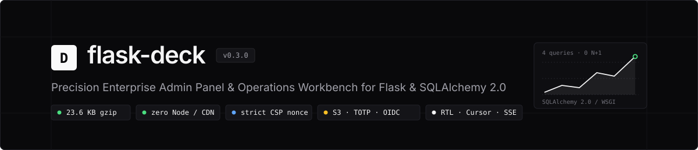
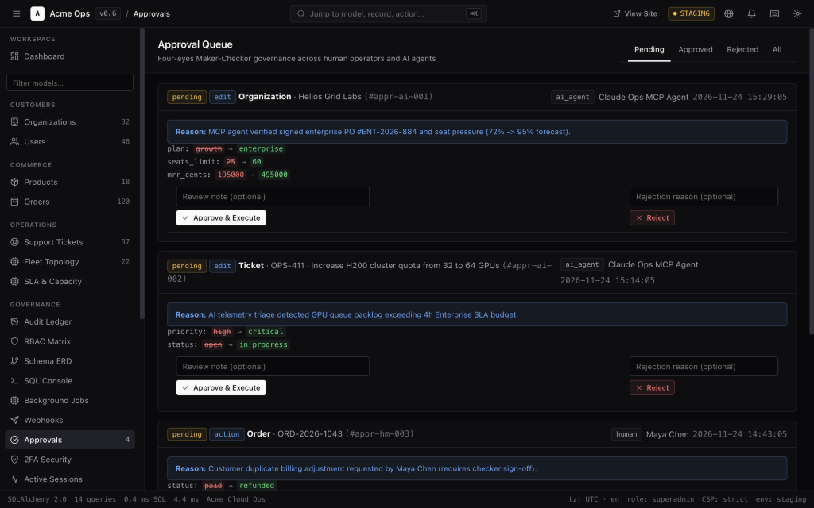
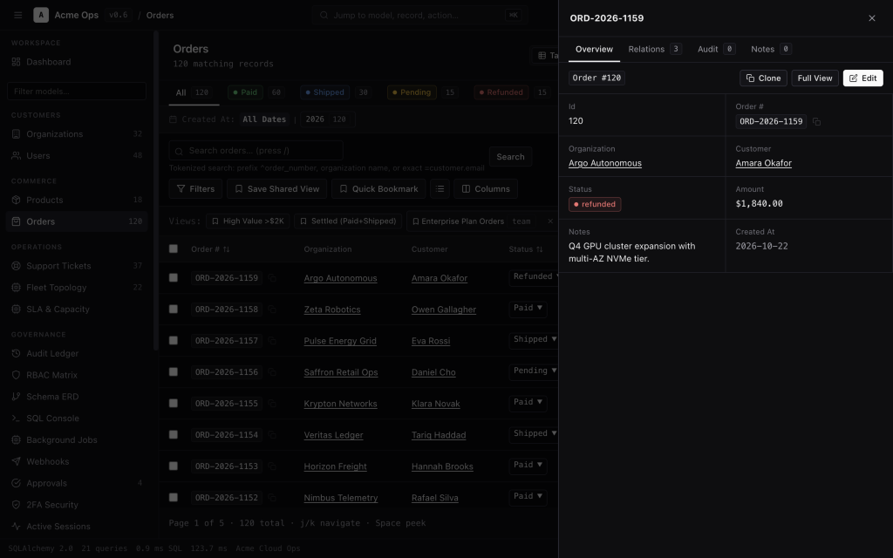
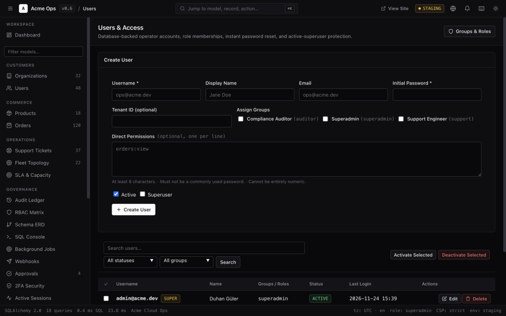
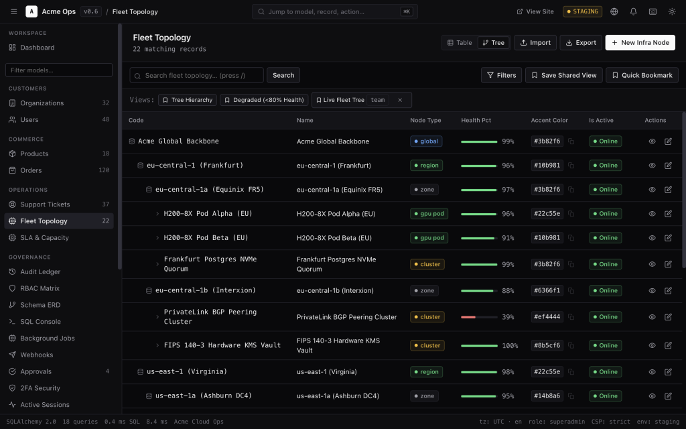
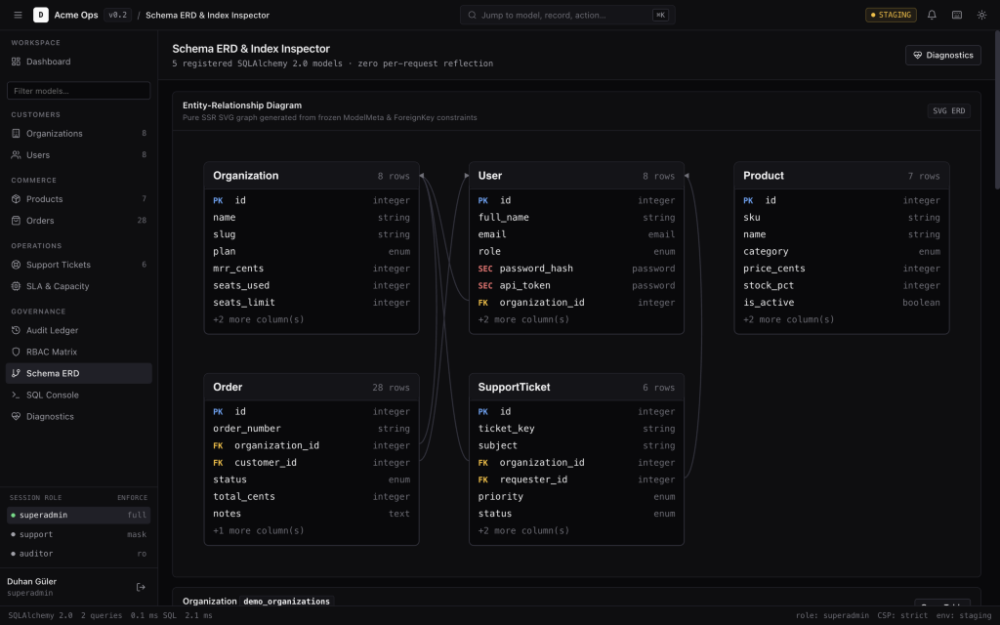

<p align="center">
  
</p>

<p align="center">
  <a href="https://flask-deck.vercel.app/admin/"></a>
  <a href="https://pypi.org/project/flask-deck/"></a>
  <a href="https://github.com/duhanguler/flask-deck/actions/workflows/ci.yml"></a>
</p>

<p align="center">
  
  
  
  
  
  
  <a href="https://github.com/duhanguler/flask-deck/blob/main/LICENSE"></a>
</p>

<h3 align="center">
  Full Django Admin parity — and far beyond — built natively for Flask &amp; SQLAlchemy 2.0.<br />
  <sub>Zero Node build · Zero external CDN · Fail-closed OWASP security · Pure SSR SVG analytics · AI-Agent HITL MCP Server</sub>
</h3>

<p align="center">
  <a href="https://flask-deck.vercel.app/admin/"><strong>Live Demo (Vercel)</strong></a> ·
  <a href="#5-line-quickstart"><strong>5-Line Quickstart</strong></a> ·
  <a href="#full-django-admin-parity--beyond-v060"><strong>What's New in v0.6.0</strong></a> ·
  <a href="#ecosystem-comparison"><strong>Comparison</strong></a> ·
  <a href="#performance-architecture--benchmarks"><strong>Benchmarks</strong></a> ·
  <a href="#security-architecture-owasp-defense-in-depth"><strong>Security</strong></a>
</p>

---

<p align="center">
  <a href="https://flask-deck.vercel.app/admin/">
    <picture>
      <source media="(prefers-color-scheme: dark)" srcset="https://raw.githubusercontent.com/duhanguler/flask-deck/main/docs/assets/dashboard-dark.png" />
      <source media="(prefers-color-scheme: light)" srcset="https://raw.githubusercontent.com/duhanguler/flask-deck/main/docs/assets/dashboard-light.png" />
      
    </picture>
  </a>
</p>

## Why `flask-deck`?

Most Python admin panels force a painful tradeoff: legacy Bootstrap/jQuery templates with weak security defaults, or heavy SPA toolchains that break in air-gapped enterprise deployments.

**`flask-deck`** is a precision, fail-closed **Enterprise & AI-Agent Operations Control Plane** for Flask and SQLAlchemy 2.0 — combining the craft of **Linear / Vercel / Django-Unfold** with full **Django Admin parity**, enterprise **IAM 2.0** (DB users/groups, Passkeys, encrypted TOTP, OIDC SSO), **Four-Eyes Maker-Checker approvals**, **hash-chained audit ledgers**, **OpenAPI 3.1 REST API v1**, **HITL MCP Server**, **media storage**, **i18n/RTL**, and **SQL BI charts** directly on WSGI.

- **Ultra-Lean, Air-Gap Ready:** Zero Node build, zero external CDN, only 5 mandatory dependencies (`flask`, `werkzeug`, `sqlalchemy`, `jinja2`, `markupsafe`). Core bundle is **`18.25 KB` gzip** (`10.50 KB` CSS + `7.75 KB` JS); modular per-route totals stay **`20.90–28.54 KB` gzip** with pure SSR SVG charts & QR codes.
- **Strict Nonce CSP by Default:** Per-request cryptographic nonce, **0 `'unsafe-inline'`**, **0 `<style>` tags**, **0 inline `style=` or `on*=` attributes**, **0 untrusted `innerHTML`**. Custom `#RRGGBB` brand themes compile into an external SHA-256 cached `/_theme.css` with automatic WCAG 2.1 contrast.
- **Full Django Admin Parity — & Beyond (`v0.6.0`):** Every power-user feature teams miss from Django Admin (`date_hierarchy`, `ListFilter`, facets, `^`/`=`/`@` tokenized relational search, dynamic per-record hooks, `VirtualField`, Rich Inlines 2.0, hybrid atomic batch editing, `raw_id_fields` lookup modal, `save_as`, `ModelViewChecks`, `get_urls()`, `createsuperuser`, `jsi18n`) **plus** modern control-plane superpowers Django Admin lacks out of the box.

---

## Try the Live Demo (Vercel or 5-Second Local)

### Option 1 — Instant Cloud Demo on Vercel

> **Live URL:** **[https://flask-deck.vercel.app/admin/](https://flask-deck.vercel.app/admin/)**
>
> | Demo Profile | Username | Password | Capabilities |
> | :--- | :--- | :--- | :--- |
> | **Superadmin** | `admin@acme.dev` | `deck-demo-2026` | Full control plane, Approvals, SQL Console, IAM 2.0, Audit Ledger |
> | **Support** | `support@acme.dev` | `deck-demo-2026` | Live email PII masking, read-only billing, no destructive deletes |
> | **Auditor** | `viewer@acme.dev` | `deck-demo-2026` | Strict read-only inspection across models & audit history |

The public Vercel demo runs the full **`showcase`** control-plane seed (32 orgs, 48 users, 18 products with thumbnails, 120 orders across 90 days, 37 support tickets, 22 infrastructure tree nodes, 36 hash-chained audit entries, pending AI-agent `Claude Ops MCP Agent` & human approvals, saved BI SQL queries, webhooks & jobs) in **Demo Safe Mode** (`FLASK_DECK_DEMO_SAFE_MODE=1`) with an automated daily **`00:00 Europe/Istanbul`** reset via [vercel.json](https://github.com/duhanguler/flask-deck/blob/main/vercel.json) and [app.py](https://github.com/duhanguler/flask-deck/blob/main/app.py).

### Option 2 — Full Interactive Local Workbench (Mutations Enabled)

```bash
uvx flask-deck demo
# or
pip install flask-deck && flask-deck demo --open
```

Open `http://127.0.0.1:5055/admin/` and try:
- **Bottom-left Session Role Switcher** (`Admin` / `Support` with live email masking / `Viewer`) and DB-backed IAM on `/admin/_security/users` & `/admin/_security/groups`.
- **Query Engine 2.0**: `date_hierarchy` drilldown, `RangeListFilter` + `EmptyFieldListFilter` + `RelatedOnlyFieldListFilter`, lazy facets, `Shift+Click` multi-column sort, and Slide-Over Quick Peek (`Space`) on `/admin/orders/`.
- **Four-Eyes AI-Agent Approvals & Hash-Chained Audit**: Approve or reject `Claude Ops MCP Agent` proposals on `/admin/_approvals`, verify SHA-256 chain integrity on `/admin/_audit`, or run & chart BI queries on `/admin/_sql`.
- **Multi-View Workspace & Arabic RTL**: Inspect Fleet Topology Tree (`/admin/infrastructure/?view=tree`), Kanban (`/admin/orders/?view=board`), Calendar (`/admin/orders/?view=calendar`), Passkeys (`/admin/_security/passkeys`), or switch to **العربية (AR · RTL)** + `Europe/Istanbul` in the topbar Globe popover.

---

## Visual Tour (`v0.6.0`)

<table>
  <tr>
    <td width="50%">
      <strong>Four-Eyes AI-Agent &amp; Human Approvals (<code>/_approvals</code>)</strong><br />
      <sub>Inspect field-level diffs from <code>Claude Ops MCP Agent</code> &amp; operators before atomic execution.</sub>
      
    </td>
    <td width="50%">
      <strong>Orders Grid, Date Hierarchy &amp; Quick Peek Drawer</strong><br />
      <sub>Single-pass Quick Tabs, SARGable <code>date_hierarchy</code>, tokenized search &amp; 4-tab slide-over drawer.</sub>
      
    </td>
  </tr>
  <tr>
    <td width="50%">
      <strong>Rich Inlines 2.0, Fieldsets &amp; Related Controls</strong><br />
      <sub>Sticky save bar, <code>Save as New</code>, Lookup/Create/Edit/Peek/Delete FK actions &amp; computed <code>@display</code> totals.</sub>
      
    </td>
    <td width="50%">
      <strong>SQL Workbench 2.0 &amp; Multi-Series Pure-SVG BI Charts</strong><br />
      <sub>Hardened read-only SQL firewall, schema browser, <code>[REDACTED]</code> secret masking &amp; sub-ms BI charts.</sub>
      
    </td>
  </tr>
</table>

<details>
  <summary><strong>Explore All 17 Additional Enterprise &amp; Workbench Views</strong> (IAM 2.0 Users, Fleet Topology Tree, Hash-Chained Audit Ledger, Swiss Light, Media Lightbox, 3-Step Wizard, Cursor &amp; Trash, TOTP QR, Revision Diff, SSE Jobs, Arabic RTL, Kanban, Heatmap, Schema ERD, SLA Page, ⌘K Palette &amp; Import Diff)</summary>
  <br />
  <p align="center"><strong>DB-Backed IAM 2.0 Users, Bulk Activation &amp; Direct Permissions (<code>/_security/users</code>)</strong></p>
  <p align="center"></p>
  <p align="center"><strong>Cycle-Safe Tree Hierarchy View (<code>/admin/infrastructure/?view=tree</code>)</strong></p>
  <p align="center"></p>
  <p align="center"><strong>Hash-Chained Audit Ledger with Verified SHA-256 Chain, Auto-Redaction &amp; Safe Revert (<code>/_audit</code>)</strong></p>
  <p align="center"></p>
  <p align="center"><strong>Swiss Light Theme (Range Switcher + Callout + Pure SVG Area &amp; Donut Charts)</strong></p>
  <p align="center"></p>
  <p align="center"><strong>Products Media Grid &amp; Click-to-Open Image Lightbox (RBAC-Guarded <code>/_media</code> Proxy)</strong></p>
  <p align="center"></p>
  <p align="center"><strong>Multi-Step Form Wizard with Drag-and-Drop Image Upload &amp; Live DataURL Preview</strong></p>
  <p align="center"></p>
  <p align="center"><strong>HMAC-Signed Keyset Cursor Pagination &amp; Soft-Delete Trash / One-Click Restore</strong></p>
  <p align="center"></p>
  <p align="center"><strong>Built-In TOTP 2FA Enrollment with Pure-Python ISO/IEC 18004 SVG QR Code (Zero External Libs)</strong></p>
  <p align="center"></p>
  <p align="center"><strong>Per-Record Side-by-Side Revision Diff History &amp; Safe Revert (<code>/&lt;slug&gt;/&lt;pk&gt;/history</code>)</strong></p>
  <p align="center"></p>
  <p align="center"><strong>Background Jobs Console with Live SSE Progress, Logs &amp; Artifact Download (<code>/_jobs</code>)</strong></p>
  <p align="center"></p>
  <p align="center"><strong>Native Arabic RTL (<code>dir="rtl"</code>) &amp; Per-User Timezone (<code>Europe/Istanbul</code>) via CSS Logical Properties</strong></p>
  <p align="center"></p>
  <p align="center"><strong>91-Day Activity Heatmap &amp; Ranked Stat Progress Bars (100% Pure SSR SVG)</strong></p>
  <p align="center"></p>
  <p align="center"><strong>Drag-and-Drop Kanban Board Mode (CSRF + RBAC + Audit Logged Transitions)</strong></p>
  <p align="center"></p>
  <p align="center"><strong>Interactive SQLAlchemy Schema ERD Inspector (<code>/admin/_schema</code>)</strong></p>
  <p align="center"></p>
  <p align="center"><strong>Custom <code>@deck.page</code> Operations View (Radial SLA Gauge + Grouped Bar + Timeline)</strong></p>
  <p align="center"></p>
  <p align="center"><strong>Global ⌘K Command Palette (RBAC-Scoped Cross-Model Live Search)</strong></p>
  <p align="center"></p>
  <p align="center"><strong>SAVEPOINT-Verified Dry-Run CSV/JSON Diff Import</strong></p>
  <p align="center"></p>
</details>

---

## Full Django Admin Parity & Beyond (`v0.6.0`)

1. **Search, Filters & Query Engine 2.0:** Tokenized multi-term & quoted search (`^startswith`, `=exact`, `@fulltext`), 1–2 hop MANYTOONE & To-Many `EXISTS` search with multi-hop RBAC barriers, `get_search_results()`, `list_select_related` (up to 3 hops), `EmptyFieldListFilter`, `RelatedOnlyFieldListFilter`, nullable `(None)` & `year`/`no_date`/`has_date` filters, numbered pagination, `show_full_result_count`, and aliased self-referential/multi-FK dotted sort & filter.
2. **Dynamic Authoring, `VirtualField`, Hybrid Batch Edit & Rich Inlines 2.0:** Per-record hooks (`get_readonly_fields`, `get_fieldsets`, `get_inlines`, `get_list_display`, `get_actions`, `can_view/edit/delete_record`, `formfield_for_foreignkey/manytomany`, `save_related`, `validate_batch`), mass-assignment-safe `VirtualField`, `radio_fields`, `raw_id_fields` paginated Lookup Modal, FK Related Delete (`×`) with cascade preview, paginated FK autocomplete, `Today`/`Now` shortcuts, `save_on_top`, atomic `inline_edit_mode="batch"` table editing, `Response`-returning `@action`, site-level `add_action`/`disable_action`, proxy multi-views, and Rich Inlines 2.0 (`file_fields`, `@display`, `readonly_fields`, `field_widgets`, `collapsible`, composite PKs, `validate_rows`).
3. **Extensibility & Startup System Checks:** `ModelViewChecks` (`DECK-E001`..`DECK-E012`, `DECK-W001`..`DECK-W002`, fail-fast in `production`), traversal-safe per-view template & same-origin media overrides, 11 allowlisted `BrandConfig.template_slots`, `ModelView.get_urls()` inheriting all security middleware, `site_url`, `sidebar_order`/`nav_order`, clickable `/_category/<cat>` index pages, and `@deck.context_processor`.
4. **IAM 2.0 & Enterprise Control Plane:** Indexed SQL-paginated `/_security/users`, bulk activate/deactivate with last-superuser guard, per-user `direct_permissions`, pluggable password validators (`strict_password_policy=True`), opt-in anti-enumeration Forgot Password (`password_reset_notifier`), CLI `createsuperuser`/`changepassword`, CSP-safe `jsi18n`, encrypted TOTP 2FA, WebAuthn **Passkeys**, OIDC SSO, Four-Eyes **Approvals**, 3-way **OCC**, Hash-Chained **Audit Ledger**, OpenAPI 3.1 **REST API v1**, and HITL **MCP Server**.

---

## Installation & Optional Extras

```bash
pip install flask-deck
```

Optional extras (zero mandatory bloat in the base wheel):

```bash
pip install "flask-deck[s3]"          # boto3 for S3 / Cloudflare R2 / MinIO
pip install "flask-deck[babel]"       # Flask-Babel / Babel catalog integration
pip install "flask-deck[pydantic]"    # Pydantic v2 form validation adapter
pip install "flask-deck[excel]"       # openpyxl for .xlsx import & export
pip install "flask-deck[webauthn]"    # Passkeys / FIDO2 WebAuthn support
pip install "flask-deck[sso]"         # authlib for OIDC / OAuth2 SSO
pip install "flask-deck[redis]"       # Redis rate-limit & import preview stores
pip install "flask-deck[enterprise]"  # Full enterprise bundle
```

---

## 5-Line Quickstart

```python
from flask import Flask
from flask_sqlalchemy import SQLAlchemy
from flask_deck import BasicAuthProvider, BrandConfig, Deck

app = Flask(__name__)
app.config["SECRET_KEY"] = "replace-with-32-byte-random-secret"
app.config["SQLALCHEMY_DATABASE_URI"] = "sqlite:///app.db"
db = SQLAlchemy(app)

deck = Deck(
    app,
    db,
    auth=BasicAuthProvider.from_plain_passwords({"admin": "change-me"}),
    title="Acme Ops",
    brand=BrandConfig(accent="cobalt", login_subtitle="Operations Control Plane"),
)
deck.register(Organization, User, Product, Order)
```

Using **pure SQLAlchemy 2.0** without `Flask-SQLAlchemy`? Pass `session_factory=SessionLocal, engine=engine` (and optional multi-DB `binds={"analytics": analytics_engine}`) directly — see [examples/pure_sqlalchemy_app.py](https://github.com/duhanguler/flask-deck/blob/main/examples/pure_sqlalchemy_app.py).

---

## Declarative `ModelView` (`v0.6.0` Authoring, Search, Batch Edit & Rich Inlines)

```python
from types import MappingProxyType
from flask import Response
from flask_deck import (
    CurrencyFormatter,
    Deck,
    EmptyFieldListFilter,
    Fieldset,
    FileFieldConfig,
    InlineModelView,
    LocalFileStorage,
    ModelView,
    RangeListFilter,
    RelatedOnlyFieldListFilter,
    SQLAlchemyAuthProvider,
    VirtualField,
    action,
    display,
)

uploads = LocalFileStorage("./uploads")


class OrderItemInline(InlineModelView):
    model = OrderItem
    columns = ("product_id", "quantity", "unit_price_cents", "line_total", "receipt_key")
    readonly_fields = ("line_total",)
    file_fields = MappingProxyType({"receipt_key": FileFieldConfig(storage=uploads, kind="image")})
    collapsible = True
    min_num = 1
    max_rows = 25

    @display(label="Line Total")
    def line_total(self, obj: OrderItem) -> str:
        return f"${(obj.quantity * obj.unit_price_cents) / 100:,.2f}"

    def validate_rows(self, rows, parent_obj, user) -> dict[str, list[str]]:
        if sum(int(r.get("quantity") or 0) for r in rows) > 500:
            return {"__all__": ["Total line quantity cannot exceed 500 units per order."]}
        return {}


class OrderView(ModelView):
    model = Order
    icon = "shopping-bag"
    category = "Commerce"
    columns = ("order_number", "organization", "customer", "status", "total_cents", "est_margin", "created_at")

    # Query Engine 2.0: prefix modifiers (^startswith, =exact), relational EXISTS, facets & date_hierarchy
    searchable_columns = ("^order_number", "organization.name", "=customer.email", "items.sku")
    list_select_related = ("organization", "customer")
    date_hierarchy = "created_at"
    show_facets = "auto"
    list_filters = (
        RangeListFilter(
            parameter_name="deal_size",
            title="Deal Size",
            column="total_cents",
            bands=(("mid", "$500–$2K", 50000, 200000), ("enterprise", "$2K+", 200000, None)),
        ),
        EmptyFieldListFilter(column="notes", title="Order Notes"),
        RelatedOnlyFieldListFilter(column="organization_id", title="Ordering Org"),
    )

    # Dynamic authoring, VirtualField, atomic Batch Edit, Save-as-New & Rich Inlines 2.0
    inline_edit_mode = "batch"
    inline_editable_columns = ("status", "total_cents")
    extra_form_fields = (VirtualField(name="audit_reason", label="Change Reason", required=False),)
    raw_id_fields = ("customer_id",)
    radio_fields = MappingProxyType({"status": "horizontal"})
    save_as = True
    save_on_top = True
    inlines = (OrderItemInline,)
    fieldsets = (
        Fieldset("Order Summary", (("order_number", "status"), ("organization_id", "customer_id"))),
        Fieldset("Billing & Notes", ("total_cents", "notes", "audit_reason"), collapsible=True),
    )
    column_formatters = MappingProxyType({"total_cents": CurrencyFormatter(currency="USD", divisor=100)})

    @display(label="Est. Margin", ordering="total_cents")
    def est_margin(self, obj: Order) -> str:
        return f"${(obj.total_cents * 0.82) / 100:,.2f}"

    def can_edit_record(self, obj: Order, user) -> bool:
        return not (obj.status == "settled" and user and not user.is_superuser)

    def formfield_for_foreignkey(self, field_name, stmt, user, obj=None):
        if field_name == "organization_id":
            return stmt.where(Organization.is_active.is_(True))
        return stmt

    @action("export_manifest", label="Download Order Manifest (CSV)")
    def export_manifest(self, records, form_data, user) -> Response:
        lines = ["order_number,total_cents"] + [f"{r.order_number},{r.total_cents}" for r in records]
        return Response("\n".join(lines), mimetype="text/csv")


# DB-backed IAM 2.0 + strict password policy + REST API v1 + HITL MCP Server + Startup ModelViewChecks
auth = SQLAlchemyAuthProvider(engine, strict_password_policy=True)
deck = Deck(
    app,
    db,
    auth=auth,
    site_url="https://app.example.com",
    enable_sql_console=True,
    enable_rest_api=True,       # OpenAPI 3.1.0 at /admin/_api/v1/...
    enable_mcp=True,            # JSON-RPC 2.0 MCP Server at POST /admin/_mcp
    mcp_require_approval=True,  # AI-agent writes validate via SAVEPOINT -> /admin/_approvals
)
deck.register(Organization, User, Product, OrderView)
```

---

## Media Wizards, Multi-View Workspaces, Async Jobs & Webhooks

```python
from types import MappingProxyType
from flask_deck import CodeWidget, ColorWidget, ModelView, SliderWidget, TagInputWidget, WebhookSink, action

class InfrastructureNodeView(ModelView):
    model = InfrastructureNode
    tree_parent_field = "parent_id"        # Cycle-safe Tree Hierarchy (?view=tree)
    calendar_date_field = "created_at"     # Opt-in Month Calendar (?view=calendar)
    gallery_image_field = "thumb_key"      # Opt-in Media Gallery (?view=gallery)
    pagination_mode = "cursor"             # HMAC-signed keyset cursor (LIMIT N+1)
    count_mode = "estimated"               # O(1) pg_class.reltuples on PostgreSQL
    soft_delete_column = "deleted_at"      # Automatic Trash tab, Restore & Force Delete
    approval_required = ("edit", "delete") # Four-Eyes Maker-Checker workflow
    field_widgets = MappingProxyType({
        "accent_color": ColorWidget(),
        "health_pct": SliderWidget(min_value=0, max_value=100, unit="%"),
        "labels": TagInputWidget(),
        "topology_yaml": CodeWidget(language="yaml", rows=6),
    })

    @action("sync_fleet", label="Sync Fleet Health", async_job=True)
    def sync_fleet(self, records, form_data, user, job_ctx):
        for idx, node in enumerate(records, start=1):
            if job_ctx.is_cancelled():
                return "Sync cancelled."
            job_ctx.set_progress(int(idx * 100 / max(len(records), 1)), f"Synced {node.code}")
        return f"Synced {len(records)} node(s)."

# Typed event bus + SSRF-hardened HMAC-SHA256 webhooks (with DLQ tracking)
@deck.on("record.updated")
def on_record_updated(event):
    print(f"{event.actor_name} updated {event.model_slug}#{event.record_pk}")

deck.add_webhook(
    WebhookSink(
        url="https://hooks.example.com/admin-events",
        secret="whsec_replace_me",
        events=frozenset({"record.created", "record.deleted", "action.executed"}),
    )
)
```

---

## Deploy Live Demo on Vercel

`flask-deck` ships with a zero-config Vercel Flask entrypoint ([app.py](https://github.com/duhanguler/flask-deck/blob/main/app.py)) and scheduled daily reset ([vercel.json](https://github.com/duhanguler/flask-deck/blob/main/vercel.json)):
- **Demo Safe Mode (`FLASK_DECK_DEMO_SAFE_MODE=1` default on Vercel):** Keeps every IAM, 2FA/Passkey, API Key, Webhook, Saved Query, Dry-Run Import, and Cascade Delete Impact control **visible for inspection** (`DEMO SAFE` / `DEMO LOCKED` badges + masked visitor IPs) while enforcing fail-closed HTTP `403` guards against mutating accounts, revoking keys/sessions, committing imports, running write REST/MCP calls, or permanently deleting records.
- **Daily `00:00` (`Europe/Istanbul`) Auto-Reset:** Vercel Schedules calls `POST /api/cron/reset-demo` daily (protected by Bearer `CRON_SECRET`), backed by an in-process midnight rollover guard.
- **Optional Env Vars:** `CRON_SECRET`, `DATABASE_URL` / `FLASK_DECK_DEMO_DB_URI`, `FLASK_DECK_SECRET_KEY`, `FLASK_DECK_DEMO_PROFILE` (`showcase` | `standard`), `FLASK_DECK_DEMO_SAFE_MODE` (`1` | `0`), `FLASK_DECK_AUTO_DAILY_RESET` (`1` | `0`), `FLASK_DECK_RESET_TIMEZONE` (`Europe/Istanbul`).

---

## Ecosystem Comparison

| Capability | **flask-deck `v0.6.0`** | `flask-admin` v2.2 | `flask-appbuilder` | `sqladmin` | `django-unfold` |
| :--- | :---: | :---: | :---: | :---: | :---: |
| **Flask / WSGI Native** | **Yes** | Yes | Yes | No (ASGI) | No (Django) |
| **Pure SQLAlchemy 2.0 + Multi-Bind DBs** | **Yes** | Partial | No | Yes | N/A |
| **Zero Node Build & Zero CDN** | **Yes (`18.25 KB` core / ≤`28.54 KB` route gz)** | Partial | Partial | No | Partial |
| **Tokenized Search (`^`/`=`/`@` + Relational `EXISTS`)** | **Yes (Multi-hop RBAC)** | Partial | Partial | Partial | Yes |
| **Dynamic Hooks, `VirtualField`, Rich Inlines 2.0 & Atomic Batch Edit** | **Yes** | Partial | No | No | Partial |
| **Slide-Over Related Drawer (`+`/`✏️`/`👁️`/`×`) & `raw_id_fields` Lookup** | **Yes (Strict-CSP)** | No | No | No | Popup only |
| **Single-Query `date_hierarchy`, `ListFilter` & Batched Facets** | **Yes** | No | No | No | Yes |
| **O(tables) SQL Cascade Delete Impact Tree & Signed `select_across`** | **Yes (Chunked async)** | No | No | No | Yes |
| **Startup `ModelViewChecks` (`DECK-E001..E012`) & `ModelView.get_urls()`** | **Yes (Fail-fast prod)** | No | No | No | Yes |
| **DB-Backed IAM 2.0, Password Policy, Forgot Password & `createsuperuser`** | **Yes** | Manual | Yes | No | Yes |
| **TOTP 2FA (Encrypted), Passkeys, OIDC SSO & Session Registry** | **Yes (Pure SVG QR + WebAuthn)** | No | OAuth only | No | Via plugins |
| **Four-Eyes Approvals & 3-Way OCC Locking** | **Yes (`ETag` / `If-Match`)** | No | No | No | No |
| **Headless REST API v1 + Scoped API Keys & HITL MCP Server** | **Yes (`OpenAPI 3.1.0` + `/_mcp`)** | No | Partial | No | DRF / Ninja |
| **Keyset Cursor Pagination + PG `JSONB`/`ARRAY` + BI SQL Charts** | **Yes (HMAC cursor + `__fts`)** | No | No | No | Partial |
| **Strict Nonce CSP (`0 unsafe-inline`)** | **Yes** | No | No | No | No |

---

## Performance Architecture & Benchmarks

Measured on Python 3.13 + SQLAlchemy 2.0 + SQLite via `uv run python benchmarks/bench_deck.py`:

| Workload | Result | Engineering Mechanism |
| :--- | :--- | :--- |
| **Frontend Asset Payload** | **`18.25 KB` core gzip** (`10.50 KB` CSS + `7.75 KB` core JS) · **`20.90–28.54 KB`** per-route total | Modular vanilla ES6 (`deck.js` + route-scoped `deck-grid.js` / `deck-form.js` / `deck-ops.js`), zero icon fonts, zero chart/QR libs; SHA-256 immutable caching (`?v=<hash>`). |
| **Offset List View (50 / 2,000 rows + FK + 4 Tabs)** | **`5.29 ms` p50 · `4` SQL queries** | Auto `joinedload`/`selectinload` (zero N+1, `lazy="dynamic"`/`write_only`-safe), single-pass `CASE` Quick Tab & Trash aggregation, `defer()` heavy blobs. |
| **Keyset Cursor List (50 / 2,000 rows, `count=none`)** | **`4.93 ms` p50 · `4` SQL queries** | HMAC-signed opaque cursor (`LIMIT N+1`, no `OFFSET` scan, zero `COUNT(*)` overhead). |
| **Enriched List (`date_hierarchy` + `RangeListFilter` + Eager Facets)** | **`6.54 ms` p50 · `6` SQL queries** | SARGable `date_hierarchy` range predicate + shared conditional facets folded right into the single-pass QuickTab query. |
| **SQL Cascade Delete Impact Analyzer (Parent + 80 Children)** | **`1.08 ms` · `2` SQL queries** | O(tables) BFS over `mapper.registry.mappers` running pure SQL `COUNT(*)` + authorized `LIMIT 5` samples with cycle deduplication & non-PK unique FK support. |
| **Streaming CSV Export (2,000 rows)** | **`57.6 ms` (`34,701 rows/s`) · `2,894 KiB` peak** | `session.scalars(stmt).yield_per(500)` + generator streaming (`O(1)` RAM) shared with Background CSV Jobs; CSV/XLSX formula & sheet-title sanitization. |
| **Dry-Run Savepoint Import (1,000 rows)** | **`153.4 ms` · `0` leaked mutations** | Chunked `IN (...)` batch preload (`batch_size=500`) + released `SAVEPOINT` validation + unconditional `finally: rollback()`; auto-async above `max_sync_import_rows`. |

Every page footer displays live request telemetry (`SQLAlchemy 2.0 · 4 queries · 0.3 ms SQL · 5.2 ms`) via lightweight request-scoped SQLAlchemy event listeners.

---

## Security Architecture (OWASP Defense-in-Depth)

| Vector | Built-in Protection in `flask-deck` |
| :--- | :--- |
| **Unauthenticated Exposure** | **Fail-closed:** Refuses to mount when `app.debug is False` without an explicit `AuthProvider` or `SECRET_KEY` (`SecurityConfigurationError`). Startup `ModelViewChecks` fail fast in `production`. Demo role switcher is hard-blocked in `production`. |
| **XSS & Script Injection** | Strict per-request nonce CSP (`default-src 'none'; script-src 'self' 'nonce-…'; style-src 'self'; frame-ancestors 'none'`), **0 `'unsafe-inline'`**, **0 `<style>`**, **0 inline `style=` / `on*=`**, **0 untrusted `innerHTML`**, hardened `render_safe_markdown` (blocking `/\evil.com` & URL attribute injection), validated `#RRGGBB` `/_theme.css`, allowlisted `template_slots`. |
| **Privilege Escalation & IAM** | Delegated `iam:manage` operators cannot grant glob/wildcard (`**`, `*:*`, `iam:*`) permissions or modify/assign privileged groups; impersonation is hard-blocked (`403`) on password, session, passkey, and API-key endpoints; deactivated user accounts immediately invalidate Bearer API keys (`401`) and password reset tokens; last-active-superuser protection. |
| **File Upload & Media Attacks** | Pure-Python magic-byte MIME verification (SVG XSS blocked by default), PNG/JPEG/GIF/WebP decompression-bomb guard (`max_image_pixels`), path-traversal-proof keys, RBAC + `can_view_record` + `scope_query` enforcement on `/_media` & inline media, `X-Content-Type-Options: nosniff`, `Content-Disposition: attachment`. |
| **Account Takeover & SSO** | `SecretCipher`-encrypted TOTP 2FA secrets & recovery codes at rest, WebAuthn Passkeys, PKCE `S256` + `state`/`nonce` OIDC SSO with `allowed_domains`, server-side Session Registry (`/_security/sessions`) with remote revocation, opt-in anti-enumeration Forgot Password (`Referrer-Policy: no-referrer`, `Cache-Control: no-store`), sliding-window login rate limiter (`429 Retry-After`), and `session.clear()` fixation rotation. |
| **CSRF, Replay & Concurrency** | Cryptographic per-session token (`hmac.compare_digest`) + `Sec-Fetch-Site` / `Origin` enforcement on every cookie mutation (plus Origin-rebinding guard on `/_mcp`), optimistic concurrency control (`ETag` / `If-Match` `409 Conflict`), and `X-Frame-Options: DENY`. |
| **Governance, Agents & APIs** | Declarative four-eyes `approval_required` Maker-Checker queue across UI, REST API v1 (`202 Accepted`), and AI-Agent MCP proposals; SHA-256 hashed Bearer API keys (`dk_live_...`) with scoped permissions, CIDR allowlists, tenant propagation, and sliding-window `429 Retry-After` throttling. |
| **Mass Assignment & Tampering** | Strict `allowed_form_fields()` allowlist + isolated `VirtualField` dicts + inline child IDOR/`validate_rows()`/`max_rows` enforcement; uniform `scope_query` & `can_view/edit/delete_record` across UI, notes, exports, audit revert, REST & MCP; cryptographic SHA-256 hash-chained Audit Ledger (`hash_chain=True`, `verify_chain()`). |
| **SQL Console & SSRF** | Dialect-aware read-only SQL firewall (blocking `\'` escapes, nested `/* /* */`, MySQL `/*!`, PG `E'...'`, PG `#` bypasses, and internal `_flask_deck_*` tables) + parenthesized `SELECT` `[REDACTED]` secret masking + unconditional transaction rollback. `WebhookSink` pins validated DNS/IPs, blocking loopback, RFC 1918, CGNAT & cloud metadata (`169.254.169.254`). |

---

## Built-In CLI & Security Auditor

```bash
flask --app yourapp deck info
flask --app yourapp deck audit --format text       # text | json | sarif (SARIF 2.1.0)
flask --app yourapp deck createsuperuser           # Interactive or --no-input DB superuser creation
flask --app yourapp deck changepassword <username> # Rotate password & revoke all active sessions
flask --app yourapp deck scaffold                  # Generate typed ModelView boilerplate from ORM
flask --app yourapp deck mcp                       # Start stdio JSON-RPC 2.0 MCP server
flask --app yourapp deck jobs list                 # Inspect / trigger @deck.scheduled_job tasks
flask-deck demo --open                             # Launch local interactive showcase workbench
```

Both `flask deck audit` and `/admin/_diagnostics` inspect `SECRET_KEY` entropy, session cookie flags (`HttpOnly`, `SameSite`, `Secure`), `OpenAuthProvider` misuse, `ModelViewChecks` findings (`DECK-E001`..`DECK-E012`), MFA/encryption/impersonation posture, REST/MCP posture, SQL console posture, unindexed `searchable_columns`, and auto-detected `flask-lens` telemetry.

---

## Migrating from `flask-admin`

See the 1-to-1 migration guide in [docs/migration-from-flask-admin.md](https://github.com/duhanguler/flask-deck/blob/main/docs/migration-from-flask-admin.md).

## Development

```bash
git clone https://github.com/duhanguler/flask-deck.git
cd flask-deck
uv sync --extra dev
make check
```

## License

MIT © 2026 [Duhan Güler](https://github.com/duhanguler)
